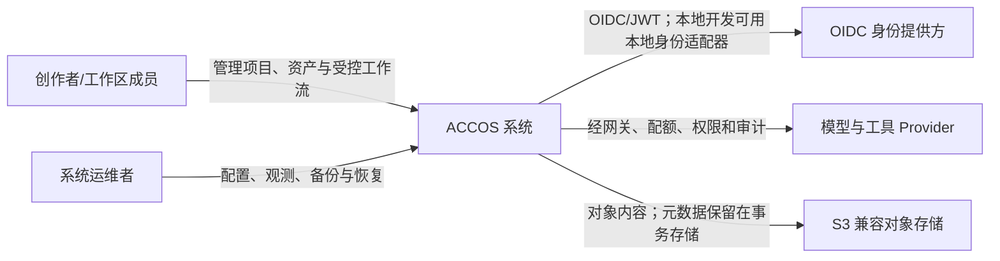

# 系统上下文

## 目的

ACCOS 为创作者提供一个可审计、可扩展的创作操作系统骨架。第一版连接创作者、Studio、ACCOS 后端和受控外部 Provider，不包含市场、支付、版权交易或自治部署。

## 人员与责任

| 参与者 | 可以做什么 | 不能绕过什么 |
|---|---|---|
| 创作者 | 在被授权工作区中管理自己的项目、内容、资产、工作流和提案 | 工作区隔离、角色权限、预算、人工批准和审计 |
| 工作区管理员 | 管理成员、角色、工作区策略和高影响批准 | 平台级安全边界、审计留痕和数据所有权 |
| 系统运维者 | 运行基础设施、观测健康、执行备份恢复 | 业务授权；运维身份不自动获得创作内容访问权 |
| 外部 Provider | 在单次获批能力调用的最小范围内处理请求 | 工作区其他数据、永久凭据、未授权工具和隐式后续调用 |

## 信任边界

1. 浏览器和所有外部调用方均不可信；API 在服务端完成身份、工作区和权限判断。
2. 模型与工具输出是不可信输入，进入领域前必须验证、限量和标注来源。
3. Redis、队列消息和 SSE 游标不形成授权事实；持久权限与状态以 PostgreSQL 为准。
4. 对象存储只保存内容，访问由短期授权或服务端代理控制；对象键不能作为权限证明。
5. Fake/Null Provider 是默认开发路径。真实调用需要显式配置、授权、配额和审计。

## 范围

### `v0.1-skeleton` 内

- 可启动、可迁移、可测试的模块化单体与 Worker 骨架。
- 工作区隔离、项目与资产、工作流、Agent、知识、记忆和质量模块的公开边界。
- Fake Provider 驱动的纵向链路、OpenAPI 客户端、Studio 页面和运行验证。

### 明确不在范围

- 真实小说、人物、世界、研究语料、正式 Prompt 或演示内容。
- 支付、市场、收益分成、版权交易和完整多人实时协同。
- 未经人工批准的代码、权限、配置或部署变更。
- 无真实负载证据的 Service Mesh、多数据库拆分或微服务化。
