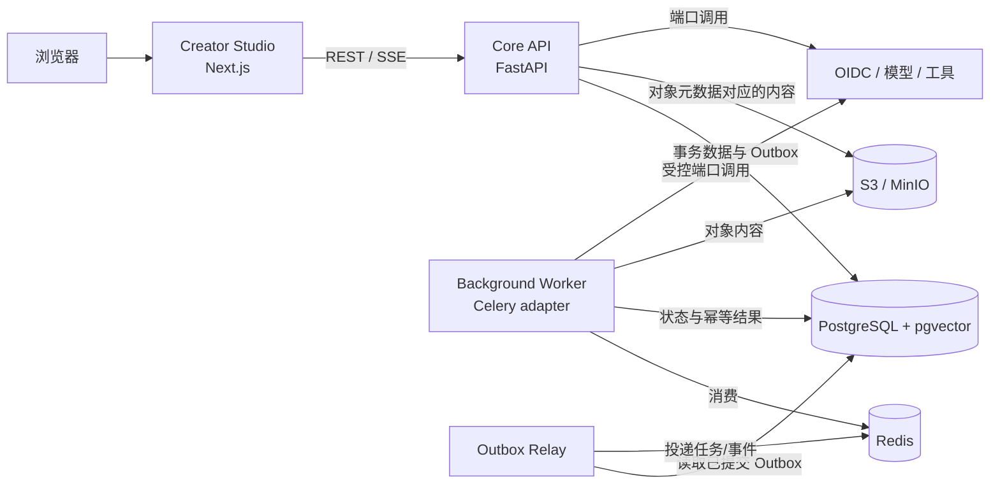

# 容器视图

## 运行容器

## 职责

| 容器 | 责任 | 不负责 |
|---|---|---|
| Creator Studio | 页面、可访问交互、本地 UI 状态、服务端状态展示 | 业务授权、持久业务规则、直接访问数据库或 Provider |
| Core API | `/api/v1`、SSE、身份与工作区边界、应用用例、事务提交 | 执行长任务、保存对象正文到事务表、直接耦合外部 SDK |
| Background Worker | 可重试、可取消、可恢复的异步步骤；持久化状态 | 成为第二套业务内核、绕过应用契约或人工批准 |
| Outbox Relay | 将已提交的 Outbox 记录可靠投递到队列 | 修改业务聚合、把 Redis 当作事实源 |
| PostgreSQL + pgvector | 事务事实、工作流状态、审计、关系与第一版向量索引 | 存储大对象正文、允许跨模块私有表访问 |
| Redis | 队列、短期缓存、锁、临时会话状态 | 持久业务事实和唯一任务状态 |
| S3 / MinIO | 对象正文与版本化二进制内容 | 决定所有权、授权或业务状态 |
| 外部 Provider | OIDC、模型和工具能力 | 获得隐式工作区访问或在领域中泄漏 SDK 类型 |

## 部署边界

- API、Worker 和 Relay 可以作为独立进程或容器部署，但来自同一个 `services/core/` 发布单元。
- 本地由 Docker Compose 组合 PostgreSQL、Redis 和 MinIO；具体版本在执行 02/03 锁定。
- 生产第一版以 OCI 镜像和单节点部署说明为目标，不引入 Kubernetes 或 Service Mesh。
- 只有满足服务拆分标准并通过 ADR 后，模块才可以变成独立发布单元。

## 关键调用链

1. Studio 通过生成的 API 客户端发送带关联 ID 的请求。
2. API 验证身份、工作区、角色、预算与必要的人工批准。
3. 应用用例在同一事务中写入模块数据和 Outbox。
4. Relay 在提交后投递；Worker 幂等消费并把状态写回 PostgreSQL。
5. API 通过可恢复 SSE 把持久进度暴露给 Studio。
