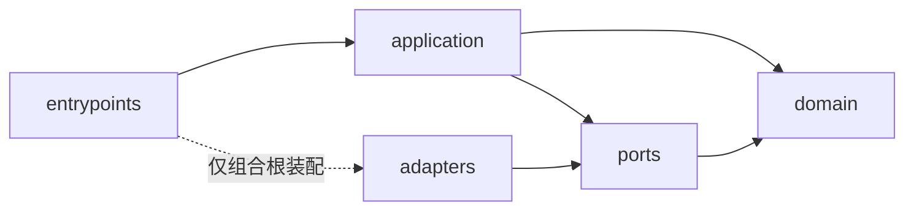

# 模块依赖规则

## 规范方向

每个后端领域模块内部遵循：

```text
entrypoints -> application -> domain <- ports <- adapters
```

完整编译期依赖如下；所有箭头均表示“左侧可以导入右侧”：



这张图是有向无环图。`domain` 不导入仓库内其他层；`adapters` 不被 application、ports 或 domain 导入。组合根只负责构造和生命周期，不承载业务规则。

## 各层职责

| 层 | 允许包含 | 禁止包含 |
|---|---|---|
| `domain` | 实体、值对象、领域服务、领域事件、领域错误 | Web/队列框架、ORM、Redis/S3、Provider SDK、其他模块私有类型 |
| `ports` | 仓储、时钟、ID、事件、模型、工具、对象存储等抽象契约 | 具体驱动、网络调用、供应商类型、业务编排 |
| `application` | 用例、事务编排、授权调用、公开命令/查询/结果契约 | 具体适配器、HTTP DTO、直接 SQL、跨模块私有表 |
| `adapters` | PostgreSQL、Redis、S3、OIDC、模型和工具端口实现 | 新业务规则、绕过端口修改领域状态 |
| `entrypoints` | REST/SSE、Worker handler、组合根、输入输出映射 | 领域决策、持久化细节、跨模块直接调用链 |

`services/core/src/accos/kernel/` 只承载关联 ID、统一错误、事务、事件、身份上下文等稳定横切契约。它不能成为杂项工具箱，也不能导入任何领域模块。

## 模块间协作

允许的方式：

1. 同步：调用目标模块公开的 application/port 契约。
2. 异步：订阅目标模块公开、版本化且经 Outbox 提交的事件。
3. 查询展示：由拥有者提供投影或查询端口；消费方不能联查拥有者私有表。

禁止的方式：

- 导入另一模块的 `domain`、`adapters`、ORM model、仓储实现或私有 DTO。
- 直接读写另一模块的表、对象前缀、缓存 key 或队列内部格式。
- 通过共享“common models”规避模块所有权。
- 在领域代码中导入 FastAPI、Celery、SQLAlchemy、Redis、S3、模型 SDK 或前端包。
- 形成同步调用环；发现双向需求时改用拥有者查询契约、事件投影或重新划分边界。

## 公开契约规则

- 每个公开契约有明确拥有者、稳定名称、版本策略和错误模型。
- 参数和结果使用内部类型，不暴露 ORM 实例或 Provider SDK 对象。
- 调用上下文显式携带主体、工作区和关联 ID，不依赖可变全局状态。
- 事件使用过去时命名，包含事件 ID、发生时间、聚合 ID、工作区和 schema 版本。
- 契约变更优先向后兼容；破坏性变更需迁移计划和消费者契约测试。

## 自动化门禁

执行 02 应配置静态导入检查，并至少验证：

- `domain` 无框架和适配器依赖。
- `application` 不导入 `adapters`。
- 模块不导入其他模块的非公开命名空间。
- `kernel` 不反向导入模块。
- Python 与 TypeScript 工作区均不存在依赖循环。

任何临时豁免必须写 ADR、指定负责人和删除日期，不能只在检查配置中静默忽略。
