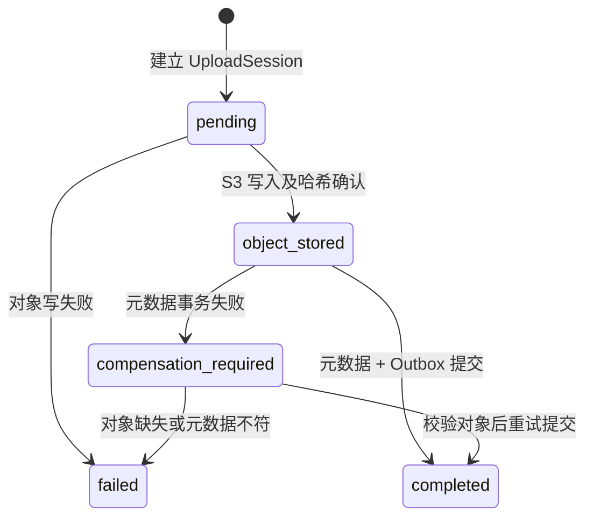

# 项目、Artifact 与资产核心

## 边界

执行 07 落地两个领域模块：

- `projects` 拥有 Project、ProjectSettings、Artifact 与 ArtifactRevision；
- `assets` 拥有 Asset、AssetVersion、UploadSession，以及 ObjectStorage 和 ContentScanner 端口。

两个模块都只公开框架无关的 dataclass、Protocol 和应用服务。SQLAlchemy Model、MinIO SDK 类型、表名和对象存储凭据不会越过 adapter/组合根边界。HTTP 路由按执行计划留到 16。

## 作用域与授权

所有查询先固定 `workspace_id`，项目级资源还必须固定 `project_id`。仅提供对象 UUID 不能进行读取或写入。找不到 scoped 资源统一按不可用处理，避免泄漏另一 Workspace 中对象是否存在。

| 操作 | 权限 | 附加策略 |
|---|---|---|
| 创建、修改项目 | `project:write` | 创建要求 Workspace scope；修改要求乐观锁版本匹配 |
| 读取项目/资产 | `project:read` | Workspace 与 Project 必须同时匹配 |
| 新建 Artifact/Revision | `project:write` | Project 必须为 `active` |
| 上传新资产/新版本 | `project:write` | Project 与既有 Asset 必须为 `active` |
| 归档 Project | `data:archive` | 仅软归档；归档后所有写入失败 |
| 标记 Asset 删除 | `data:request-delete` | 只写标记和保留期限，不删除对象或数据库行 |

## 版本与事件

- Project 和 Artifact 使用整数乐观锁；并发写者提交过期版本时得到 `concurrency_conflict`。
- ArtifactRevision 与 AssetVersion 只追加；编号在各自容器内从 1 递增。
- `projects.project-created`、`projects.project-settings-updated`、`projects.project-archived`、`projects.artifact-revision-created`、`assets.asset-uploaded`、`assets.asset-deletion-marked` 均使用 schema v1，并与业务记录在同一数据库事务写入 Outbox。
- 同一 Workspace 内的项目创建幂等键使用 `projects.create` scope；同键同输入返回首次结果，同键不同输入返回 `idempotency_conflict`。

## 对象命名与上传状态

对象键固定为：

```text
workspaces/{workspace_uuid}/projects/{project_uuid}/assets/{asset_uuid}/versions/{asset_version_uuid}
```

键中没有用户文件名，也不接受绝对路径、反斜杠、空片段、`.` 或 `..`。上传还校验非空大小、10 MiB 默认上限、扩展名/MIME allowlist 和调用者提供的 lowercase SHA-256。

ContentScanner 是可替换端口。当前组合根使用 `UnconfiguredContentScanner`，资产真实记录 `scan_status=not_configured`，绝不会写成 clean。配置扫描器后，`rejected` 阻止写入，`failed` 失败关闭。



数据库已存在而对象缺失或哈希不符时，AssetVersion 进入 `missing_object`；对象恢复且下载哈希验证通过后回到 `available`。对象先写成功、数据库最终事务失败时保留 `compensation_required` UploadSession，通过 `resume_upload` 继续，不执行永久清理。

