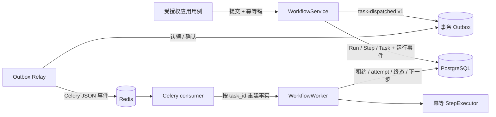
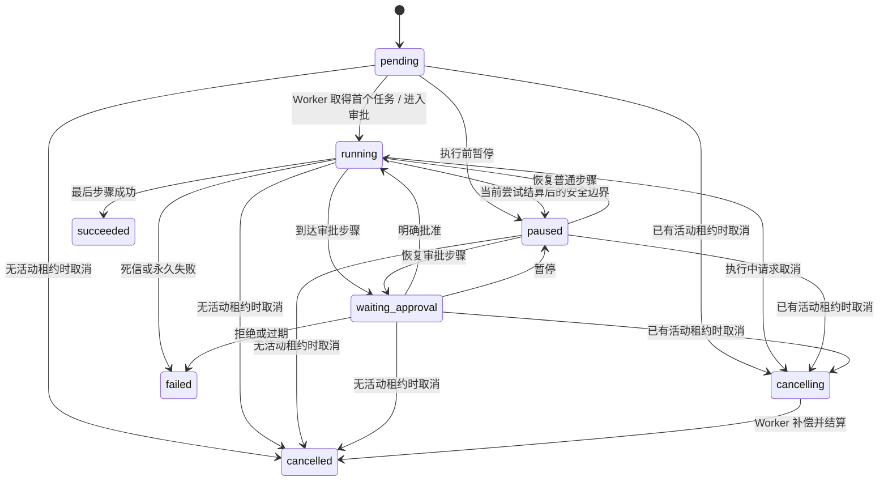

# 事件、任务与工作流引擎

## 边界与唯一调度权

执行 08 落地 `workflows` 模块，拥有版本化 `WorkflowDefinition`/`StepDefinition`、`WorkflowRun`、`StepRun`、`TaskRun`、审批和运行事件。Workflow 是长任务的唯一调度者；后续 Agent、Director 或 Master 只能选择、提交或规划 Workflow，不能越过模块公开契约写其他模块的数据。

领域和应用层只依赖框架无关的 dataclass 与 Protocol。SQLAlchemy、Celery 和 Redis 类型只存在于 adapters 与 composition root。PostgreSQL 是定义、运行状态、幂等、租约和事件的唯一事实源；Celery/Redis 只传送已提交的 Outbox 事件，Celery result backend 被禁用。

Worker 进程的 Relay 使用主 Selector event loop；Celery `solo` consumer 在其工作线程中执行。两者不能共享 SQLAlchemy 异步连接池，因此 consumer 使用独立的 `NullPool` session factory。这样每次 Celery 调用建立自己的数据库连接，不把 loop-bound pooled connection 带到另一个事件循环。

## 持久模型

| 模型 | 核心不变量 |
|---|---|
| WorkflowDefinition | `name + version` 唯一；步骤位置从 0 连续；相同版本不可变 |
| StepDefinition | kind、每次尝试 timeout、有限 retry policy、可选审批过期与 compensation hook |
| WorkflowRun | Workspace/Project scope、提交幂等键、当前步骤、输入/输出/错误引用、控制请求时间 |
| StepRun | 当前步骤状态、attempt、deadline 和引用；Run 内 position 唯一 |
| TaskRun | Workspace 内幂等键唯一；available/deadline、lease token/expiry、最后投递事件 ID |
| ApprovalRequest/Decision | 显式请求、actor、reason、expiry；请求者不能批准自己的请求，非用户主体不能决定 |
| WorkflowRunEvent | schema v1；每个 Run 的 sequence 从 1 严格递增，为后续 SSE cursor 预留 |

定义、运行事件和审批决定等不可变记录由 PostgreSQL trigger 拒绝 UPDATE/DELETE。运行、步骤和任务状态只在持有行锁/租约的仓储事务中改变。

## Run 状态机

`succeeded`、`failed`、`cancelled` 是终态。执行中暂停只写 `pause_requested_at`，不抢占正在运行的执行器；当前尝试成功或进入重试时才在安全边界变成 `paused`。执行中取消先进入 `cancelling`，Worker 无论随后成功、超时还是失败都优先补偿并结算为 `cancelled`，不会非法转为 `failed`。

## 至少一次、重试与恢复

- Run 提交用 `(workspace, workflows.submit:{definition}, key)` 保留幂等记录；同键同请求返回原 Run，不同请求摘要报冲突。
- Run/Step/Task 和 `workflows.task-dispatched` Outbox 事件在同一事务提交。队列不可用只使 Outbox 进入有界重试，不会删除业务状态。
- Celery 使用 JSON、late ack、worker-lost reject、prefetch 1、无 result backend；consumer task 为 app-private，避免多个 Celery app 的同名 handler 相互污染。
- Worker 认领 Task 时持有数据库行锁，写入 lease token/expiry 并递增 attempt。活动租约期间重复投递被忽略；租约过期后新 Worker 可重新认领。
- StepExecutor 收到稳定的 `{run_id}:{step_key}` 幂等键。框架 smoke 没有外部副作用，输出引用确定；未来拥有真实副作用的模块必须在自己的事实源中持久化该幂等结果。
- retry policy 是指数退避并有 max attempts/maximum delay。耗尽尝试或永久失败后 Task 进入 `dead_letter`、Step/Run 进入失败终态；系统没有无限重试。
- 每次尝试同时受 `asyncio.timeout` 和持久化 deadline 约束。未知异常只保存稳定 `workflow-error://internal`，不泄漏内部详情。
- 最终失败或取消可调用声明的 compensation hook；补偿失败保存 `workflow-error://compensation-failed`，留给人工诊断。

## 人工审批与运行事件

审批步骤不创建可执行 Task，而是持久化 `waiting_approval` 请求。请求必须有正数过期时间；决定必须来自具备 `approval:decide` 的不同人类 actor，并记录 actor、reason 和 UTC 时间。拒绝与过期进入明确失败终态；不存在默认或自动批准路径。

运行事件与状态事务性提交，事件类型包含提交、派发、开始、重试、成功、暂停/恢复、取消、审批请求/批准/拒绝/过期和死信。查询必须带 Workspace scope，并支持 `after_sequence`；HTTP/SSE 暴露统一留到执行 16/17。

## `framework_smoke` v1

内建 smoke 只处理 `fixture-token://` 技术引用：传递引用、第一次受控失败后重试、执行 10 ms 可控延迟并保存元数据。三个步骤每次尝试 timeout 为 10 秒，最多 3 次，退避从 1 秒开始并封顶 8 秒。它不生成小说、研究、人物、世界或其他创作内容。

