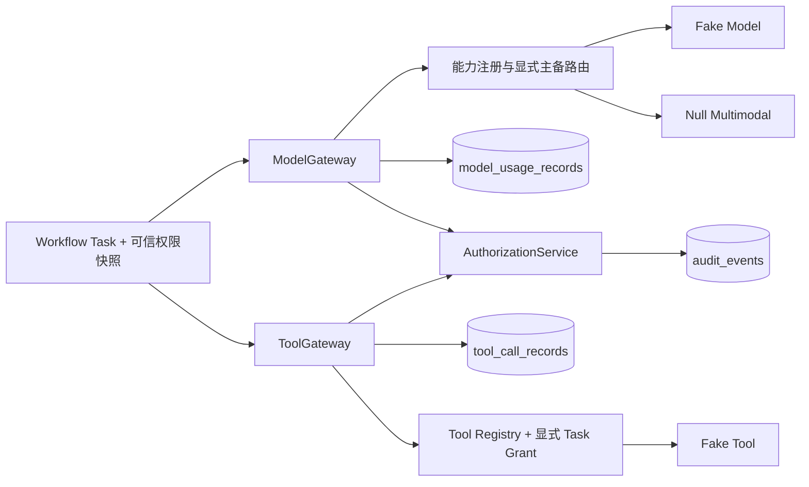

# 模型、工具与插件边界

## 已落地范围

执行 09 新增 `models` 与 `tools` 两个拥有独立公开契约和账本的模块。领域模块、Workflow 与后续 Agent 只可调用 `ModelGateway`/`ToolGateway`，不得导入 Provider、工具运行器或供应商 SDK。默认 composition 只注册确定性的 `fake-model`、明确返回 `NOT_CONFIGURED` 的多模态 Null Provider，以及无网络、无 Shell、无文件权限的 `fixture.reference` Fake Tool。

## 模型协议与策略

`ModelCapability` 首期可执行能力为 `text` 与 `embedding`；`image`、`audio`、`video`、`3d` 已有稳定枚举和 Null 适配器，但未配置真实实现时只能返回 `NOT_CONFIGURED`。`ModelRequest` 只接受有界 opaque reference、幂等键、最大 token、Workflow/Task ID 和可选的已激活元数据引用，不接受 Prompt 正文或密钥。

默认 `ModelPolicy`：

| 项目 | 默认值 |
|---|---:|
| Provider | allowlist/primary 均为 `fake-model`；无隐式供应商选择 |
| 单次 timeout | 1 秒 |
| 每 Provider 重试 | 1 次 |
| 退避 | 10 ms 起步，有限指数退避 |
| 单次路由总尝试 | 4 次，主备共享 |
| 熔断 | 连续 2 次失败；30 秒冷却 |
| Provider 并发 | 每进程 2 |
| Workspace token / 调用 | 100,000 / 1,000 |
| Task token / 调用 | 4,096 / 16 |
| 单次最大 token | 1,024 |

每次真实 Provider 尝试、预算拒绝、未配置能力与熔断跳过都会产生 `UsageRecord`。重试和主备切换沿用同一 Workspace/Task 已用额度与总尝试计数，不会重置预算。Provider 原始异常、响应和凭据不会进入账本或 Workflow error reference。

## 工具与资源权限

`ToolDescriptor` 固定工具 ID、语义版本、输入/输出 object schema、所需 RBAC 权限、网络 host、相对文件 root、资源类型、timeout、幂等属性和审计策略。`ToolGrant` 由可信 Workflow/任务上下文明确给出 Workspace、Project、Task、允许工具、允许权限和资源范围；安装或注册工具不会生成 Grant。

每次调用按以下顺序失败关闭：统一 RBAC → 工具存在 → Task Grant → Descriptor 与 Grant 范围交集 → 输入 schema → timeout 内执行 → 输出 schema → append-only 调用记录。默认 Descriptor 的网络 host、文件 root 和资源类型均为空；协议没有 Shell 开关，因此无法请求任意命令执行。工具账本不持久化输入/输出 payload。

## 插件与 Prompt/Policy 元数据

`RepositoryPluginLoader` 只读取配置根目录内名为 `manifest.json` 的 JSON，阻止 `..` 逃逸、URL/远程下载和代码装载。manifest 声明插件 ID、版本、核心兼容范围、能力、权限、签名和启用状态；信任状态由加载器的本地可信签名集合计算，不能由 manifest 自报。当前唯一 fixture manifest 只存在于测试目录。

`PromptPolicyMetadata` 只保存 ID、`prompt|policy`、语义版本、SHA-256 校验和与 `draft|active|retired` 状态。注册表禁止同一版本被替换，也不存正式 Prompt、写作模板或 Agent 人设。

## 安全不变量与已知边界

- Provider/Tool 失败不会增加权限、改写 Grant 或放宽预算。
- `SecretProvider` 是凭据唯一读取端口；默认 `NullSecretProvider` 始终不返回凭据。
- Fake 输出只由 Provider/Tool ID、幂等键和能力确定，不读取真实内容、不访问网络、不写文件。
- 调用账本和 Identity 审计均可由 Workspace、Workflow、Task 与 correlation ID 关联。
- 当前路由、配额与注册表是单进程代码配置；多节点强一致预算预留、真实 Provider SDK、插件市场和远程插件下载不在本阶段范围。任何真实接入必须先增加凭据隔离、数据区域和并发预算的适配器级契约测试。
