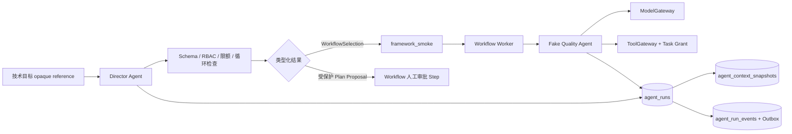

# Agent 运行时与总控编排

## 已落地范围

执行 10 新增无状态 `agents` 模块。Agent 只持有版本化描述符、一次运行的可信上下文快照、元数据结果引用和用量结算；它不拥有 Workflow 调度状态，也不直接访问 SQL、Redis、S3、模型 SDK、Shell、网络或文件系统。Director/Master 只把技术目标解释为 `WorkflowSelection` 或 `WorkflowPlanProposal`，随后把持久调度交给 Workflow Engine。

## 描述符与注册

内置注册表只登记七个无内容描述符：Director、Research、World、Character、Writer、Editor、Quality。每个 `AgentDescriptor` 固定 Agent ID、语义版本、能力名、输入/输出 object schema、允许工具 ID、模型策略版本、Prompt 元数据 ID/版本/校验和与预算上限。描述符不含 Prompt 正文、人设、知识、创作规则或业务样例。

Director 的合法输出只有：

- `WorkflowSelection`：固定工作流名称、版本和 opaque 输入引用；当前 allowlist 仅接受 `framework_smoke@1`。
- `WorkflowPlanProposal`：固定目标工作流元数据、opaque 提案引用、受保护操作集合和 `approval_required=true`。

其他 Agent 只能返回 `proposal` 或 `draft` 引用。Canonical 数据、所有权、权限、发布或删除被列为受保护操作时，Master 只提交 `agent_plan_review@1`，其首个步骤是 Workflow 拥有的人工审批；本阶段不会执行提案中的变更。

## 执行安全边界

所有限制取平台硬上限、Descriptor 上限和调用方显式上限的交集。调用方只能收窄，不能扩张。默认平台/Descriptor 硬上限为：

| 限制 | 上限 |
|---|---:|
| 规划步骤 | 16 |
| 递归深度 | 3 |
| 并行数 | 4 |
| 总时长 | 30 秒 |
| 模型与工具总调用 | 8 |
| 总 token | 2,048 |

`framework_smoke` 的 Quality Agent 进一步收窄为 2 步、深度 1、并行 1、10 秒、2 次调用和 64 token。模型网关与工具网关原有预算/权限仍独立生效；Agent 限额不能重置或替代它们。

以下情况失败关闭并保存稳定错误/终态：未知 Agent、输入/输出 schema 不匹配、未列入 Descriptor 的工具、缺失 Tool 版本或权限、预算扩张/耗尽、步骤/递归/并行/时长超限、规划路径重复以及执行器异常。Agent 没有通用 Shell、任意网络、任意文件或跨工作区协议。

## 快照、重放与事件

每个新运行先持久化不可变 `AgentContextSnapshot`，包含 Agent 版本、模型策略版本、Prompt 元数据版本与校验和、Descriptor 允许工具的精确版本、排序后的权限快照和规范化输入的 SHA-256；不保存输入正文或 Prompt 正文。运行使用 Workspace 级幂等键。重投相同摘要返回首次结果，不重新调用 Fake Agent、Model 或 Tool，也不重复结算用量；同键不同摘要返回 `idempotency_conflict`。

`agent_runs` 保存状态、尝试、上下文引用、Workflow 引用、结果类型/引用、模型/工具调用数、token 和稳定错误码。`agent_context_snapshots` 与 `agent_run_events` 由数据库 trigger 保护为 append-only。每次开始、成功、失败和 Workflow 绑定同时产生 Agent 事件与事务 Outbox 事件；当前 metrics sink 仅保存进程内稳定 Agent ID/状态计数，执行 22 再接统一遥测后端。

## 依赖不变量

- `agents` 只依赖 `models.public`、`tools.public`、`workflows.public`、`identity.public`、`projects.public` 和 kernel 契约。
- Agent 执行器只通过 `ModelGateway` 与 `ToolGateway` 访问外部能力；每个 Tool 请求均有可信 Task 生成的显式 `ToolGrant`。
- Workflow Engine 是唯一长期状态调度者；Agent Supervisor 只执行一次有时限的无状态调用并持久化审计证据。
- 真实 Agent Prompt、领域策略、远程工具、自治组织、自繁殖、自改代码或自行部署均不在本阶段。
