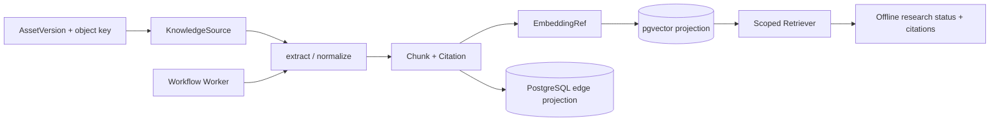
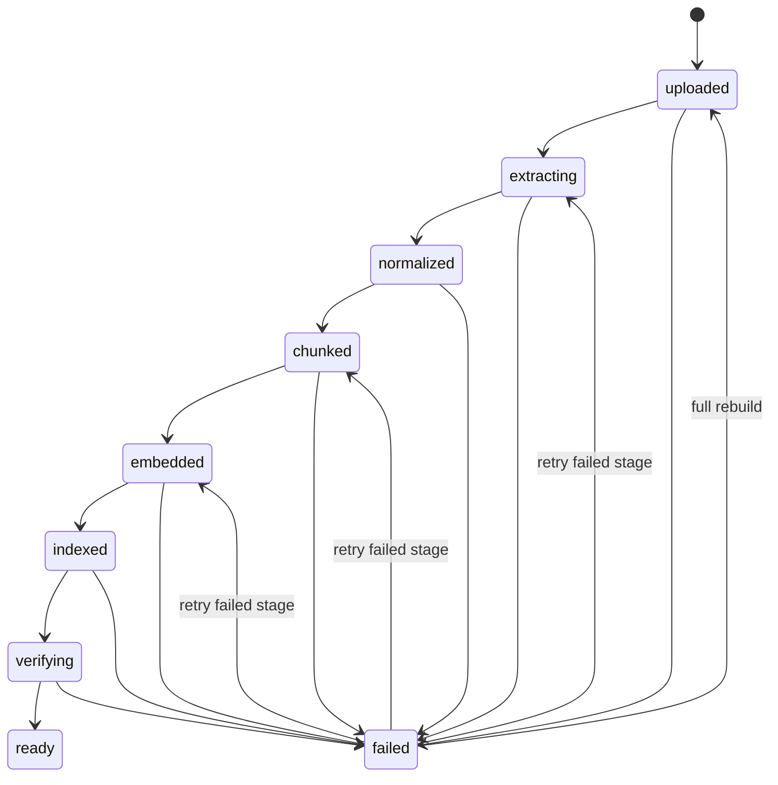

# 知识采集、检索与离线研究骨架

## 已落地范围

执行 11 新增独立 `knowledge` 模块，把一个已通过 Assets 边界保存的不可变资产版本转换为可追溯、可删除并可重建的检索投影。当前只配置 UTF-8 纯文本/Markdown、确定性分块、8 维 Fake Embedder、PostgreSQL/pgvector 索引和最小关系边；PDF、DOCX、外部数据库与远程来源均显式返回 `NOT_CONFIGURED` 类错误，不联网、不调用模型、不包含真实知识。

## 事实与投影

`knowledge_sources`、`knowledge_documents`、`knowledge_document_versions`、`knowledge_ingestion_runs` 保存事实、来源和恢复检查点。原始字节仍由 Assets/ObjectStorage 拥有；Knowledge 只保存不可变 asset/version 引用、对象定位符与内容哈希。`knowledge_chunks`、`knowledge_embedding_refs`、`knowledge_citations`、`knowledge_vector_index` 和 `knowledge_edges` 是从上述事实可重建的投影。

更新资产会创建新的 `KnowledgeSource`、`DocumentVersion` 与 `IngestionRun`，但复用同一个逻辑 `Document`。只有最新完成的版本被标记为 `active + ready`；旧版本的来源、分块和引用继续保留用于审计，但检索许可集合排除旧版本。重建会清空当前版本的规范化文本、分块、嵌入、引用、向量和关系边投影，再从资产定位符与哈希重新执行，不修改原始资产。

## 状态与验证语义

失败 Run 必须保存 `failed_stage`、稳定 `error_code` 和 `retryable`；重试从失败检查点恢复，不重复已完成的 chunk。全量重建显式回到 `uploaded` 并替换投影。

验证状态独立于采集状态：

- `verified`：已配置验证器并明确通过；
- `unverified`：验证器无法确认；
- `not_configured`：未配置验证器，绝不等同 `verified`；
- `rejected`：验证器明确拒绝。

`NOT_REQUIRED` 策略允许以 `not_configured` 进入 `ready`。`REQUIRED` 策略只有 `verified` 能进入 `ready`；其他三种结果分别映射为稳定失败码。

## 检索隔离与来源

可信 `SecurityContext` 决定 `workspace_id`，调用方只能选择同工作区内的 `project_id`。仓储先生成 `active + ready` 版本许可集合，再把同一 Workspace/Project/Version 条件传给向量索引；向量命中之后仍需通过 scoped repository 回填 Chunk/Citation。任一层的跨 Workspace、跨 Project 或过期版本查询都返回空结构，不暴露资源是否存在。

每个 `RetrievalHit` 同时包含分数、Chunk 和 Citation。Citation 固定 source、document、document version、asset、asset version、chunk、locator 与真实 verification status。空检索返回原查询与空 `hits`，不是异常。

生产 PostgreSQL 使用 `vector(8)`、HNSW 与 cosine operator。Windows 集成测试环境如果只提供名为 `vector` 的 text-domain 兼容 shim，则迁移保留同名列与普通索引，适配器用相同 8 维向量执行确定性余弦回退。两条路径共享 replace/search、范围与错误契约。

## Workflow 与研究边界

`knowledge_ingestion@1` 只有一个 `knowledge-ingest` reference step。输入是 `knowledge-run://<uuid>`；Worker 从持久 Run 检查点恢复。Worker 在领取任务后退出时，Workflow 租约到期可由新 Worker 重新领取，Knowledge Service 从最后检查点继续；确定性 ID、仓储替换语义和 Run 幂等约束阻止重复 chunk/index。

`ResearchService` 只执行离线技术链：opaque question reference -> deterministic plan reference -> offline material-request reference -> scoped retrieval -> report reference/citations。它不会创建查询 Prompt、访问外网或把模型常识标记为来源。

## 依赖不变量

- `knowledge` 只通过 `assets.public`、`projects.public`、`identity.public` 与 `workflows.public` 协作；不导入其他模块的私有 ORM。
- Agent、Memory 与未来 API 只能调用 Knowledge 公共检索契约，不能直接访问向量表、S3 或 SQLAlchemy。
- 原始资产、规范化事实与可重建投影分属明确所有权；删除投影不得删除资产。
- Provider/数据库异常只映射为稳定状态，不向调用方泄漏 SDK、SQL、连接或对象存储错误文本。

