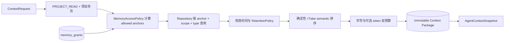

# 七层记忆与上下文架构

## 范围

Memory 模块把“记忆层级”和“记忆类型”建成正交维度。七层共享一套 `MemoryRecord` / `MemoryLink` 版本模型、一套授权入口和一套 PostgreSQL 事实源；没有七套表、没有真实作者偏好或创作内容，也没有 LLM 摘要 Prompt。

公开端口包括 `MemoryWriter`、`MemoryRetriever`、`MemoryRanker`、`MemoryCompressor`、`RetentionPolicy`、`ConflictResolver`、`MemoryRepository`、`MemoryProjection` 与 `ContextPackageReader`。首期排序使用离线 `FakeSemanticMemoryRanker`：语义贡献固定为零，结果只由可验证的 scope、有效时间、重要度/置信度、保留降权、来源等级、观察时间和 UUID 决定；以后接 pgvector 排序时仍须置于授权 anchor 过滤之后。

## Scope / Type 矩阵

Scope 决定保留周期和授权 anchor；type 是可扩展的小写标识，可独立过滤。首期允许 `project`、`character`、`world`、`event`、`decision`、`preference`、`system` 等标识，但数据库不把类型封死为枚举。

| Scope | 必需 anchor | 典型保留策略 | 可与任意 type 组合 | 跨项目读取 |
|---|---|---|---|---|
| `working` | `project_id` | TTL | 是 | 禁止 |
| `session` | `project_id` | TTL / decay | 是 | 禁止 |
| `project` | `project_id` | keep / decay | 是 | 禁止 |
| `universe` | `universe_id` | keep / decay | 是 | 仅显式 Universe grant |
| `creator` | `creator_id` | keep | 是 | 本人或显式 Creator grant |
| `experience` | `creator_id` | decay / keep | 是 | 本人或显式 Creator grant |
| `wisdom` | `creator_id` | keep | 是 | 本人或显式 Creator grant |

领域对象和数据库约束均要求每条记录恰好拥有其 scope 对应的 anchor。`working/session/project` 不能通过空 `project_id` 变成全局记录；Universe 与 Creator 系列也不能混入项目 anchor。

## 授权优先的检索

Repository 的检索方法不接受裸 `workspace_id/project_id` 查询，而只接受预先计算的 `AllowedAnchor` 集合。空集合直接返回空结果。当前项目自动获得三种项目 anchor；当前 actor 自动获得自己的 Creator/Experience/Wisdom anchor。其他 Universe 或 Creator anchor 必须来自目标项目上的活动 grant。未经授权的记录不会被读取，也不会通过 omission 泄漏其 ID；只返回通用 `anchor_unavailable`。

项目 scope 永远不能跨项目读取。跨项目共享只通过 `memory_grants` 中的 Universe 或 Creator anchor 发生，并且仅开放该 anchor 对应的 scope。

## 事实、版本与来源

`MemoryRecord` 保存：

- `logical_id + version`、`status + current`；一个 logical memory 同时最多一个 current 版本；
- workspace/project/universe/creator anchor；
- valid time、observed time、importance、confidence；
- `MemoryProvenance(kind, opaque reference)`，可引用公开的 `knowledge-citation://...`，不读取 Knowledge 私有表；
- `RetentionRule` 和创建者/创建时间。

压缩器只做确定性的有界技术夹具压缩，输出新记录，并以 `summary_of` MemoryLink 指向全部来源记录。旧记录和来源引用保留。冲突先写入 `candidate` 版本和 `MemoryConflict`；批准时先撤销旧 current，再激活候选，拒绝时归档候选。未决定的候选不参与有效上下文。

## 保留与“遗忘”

| 策略 | 首期行为 | 是否物理删除 |
|---|---|---|
| `keep` | 分数乘数 1 | 否 |
| `ttl` | 到期后排除，原因 `ttl_expired` | 否 |
| `decay` | 按半衰期确定性降权 | 否 |
| `archive` | 排除，原因 `retention_archived` | 否 |
| 手工 forget | 状态变为 `archived` 并追加 MemoryEvent | 否 |

valid time 还会产生 `not_yet_valid` 或 `no_longer_valid`。所有 omission 均写入 Context Package；未授权 anchor 只有通用原因。

## Context Package 与 Agent

Context Builder 输入任务引用、项目、允许的 scopes/types、字符预算和可选 token 预算。token 使用固定 `ceil(chars/4)` 技术估算，只用于硬上限，不伪装成模型 tokenizer。Builder 保证两个已配置预算都不超限，并为有效时间、保留、授权 anchor 和预算省略返回稳定机器码。

Context Package 持久保存允许的 anchor 快照、排序后的内容、分数、每条 provenance、所有 omission、预算使用量和 SHA-256。Agent 运行时只接受 `memory-context://<uuid>`；Supervisor 验证 package 属于同一 workspace/project，随后只把 package ID 写入不可变 `AgentContextSnapshot`。Agent 模块没有扫描 Memory 表的入口。

## 存储与重建

迁移 `0008_memory_context` 新增：

- `memory_records`、`memory_links`；
- `memory_grants`、`memory_conflicts`；
- `memory_context_packages`、`memory_events`；
- `agent_context_snapshots.memory_context_package_id`。

PostgreSQL 是全部事实、决议和快照的唯一事实源。Redis 投影只保存 Working/Session 的 record UUID 列表，带 TTL，不保存事实内容；`MemoryProjectionRebuilder` 只用项目 allowed anchors 从 PostgreSQL 重建。清空 Redis 不会删除或改变任何 MemoryRecord。

