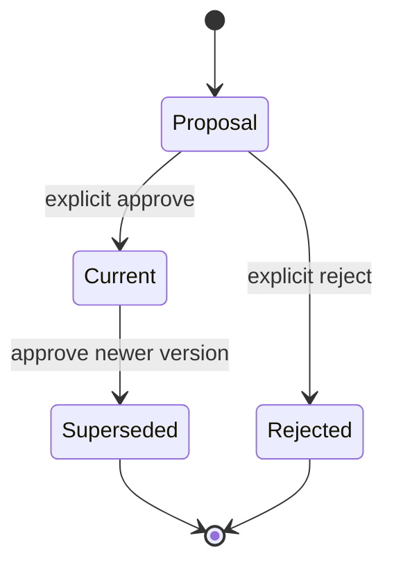

# 小说、世界、人物与作者模型架构

## 范围与唯一归属

执行 13 把重复的创作引擎收敛到 `accos.modules.creative` 一个包边界，内部只有 Novel、World、Character、Creator 四个数据所有者。这里只有空容器、结构/状态元数据、命令、查询、事件 schema 和扩展端口；没有小说内容、世界设定、人物档案、作者偏好值、Prompt、模拟或生成算法。

| 原规划中的重复概念或目录 | 唯一模块 | 当前模型 |
|---|---|---|
| novel engine、story/plot/chapter service、作品编排 | `creative.novel` | `Work`、`ConceptRef`、`ThemeRef`、`PlotPlan`、`Chapter`、`DraftRevision`、`EvaluationRequest` |
| world engine、world service、文明/地点/规则/模拟 | `creative.world` | `World`、`WorldState`、`WorldRule`、`Civilization`、`Location`、`WorldEvent`、`ImpactLink`、`ScenarioRequest` |
| character engine、psychology/relationship/growth service | `creative.character` | `Character`、`CharacterState`、`PsychologyState`、`Relationship`、`GrowthArc`、`GrowthEvent`、`Motivation`、`BehaviorProposal` |
| author/creator model、style/preference/learning engine | `creative.creator` | `CreatorProfile`、`PreferenceSignal`、`StyleProfile`、`DecisionRecord`、`EvaluationPreference` |

仓库中不得再建立 `backend/world_engine`、`services/world` 或其他第二套创作事实模块。Novel 只保存带类型的 World/Character ID 引用，不复制相应实体或仓储。

## 数据与状态模型

PostgreSQL 使用两张统一但带强 owner 约束的表：

- `creative_containers` 保存四类空聚合根；`owner` 只能是 `novel/world/character/creator`。
- `creative_records` 保存 24 类状态/结构元数据。复合外键同时匹配 aggregate ID、owner、workspace 和 project，数据库层阻止跨 owner 或跨项目挂接。

公开契约只包含 UUID、枚举、版本、顺序、带类型的 `CreativeReference` 和 opaque URI，不包含 ORM、正文或自由文本状态负载。`logical_id + record_version` 唯一；一个 logical record 同时最多一个 current。

提案未批准时 `current=false`，不会改变已接受事实。审批事务锁定容器并校验 `expected_container_version`，旧 current 先变为 `superseded`，再激活候选。归档项目可以读取历史元数据，但不能创建、提案或审批。

## 模块协作

- Project：所有读写先经公开 `ProjectRepository`、统一 `AuthorizationService` 和 workspace/project scope；Creative 不读取 Project 私有表。
- Workflow：`creative://<owner>/<uuid>` 由 `CreativeCatalog` 解析；`CreativeWorkflowExecutor` 仅处理 `creative-reference`，其他步骤委托已有执行器。
- Knowledge、Memory、Agent：只允许保存带类型的公开 ID/opaque URI；Creative 不导入其私有领域或表模型。
- Feedback：本阶段没有订阅。Creator 只公开 `PreferenceSignalIngestPort` 和 `creative.creator.preference-signal-ingested.v1` schema 占位；执行 15 再接线。

## 双向事件防循环

WorldEvent 只能形成 Character `BehaviorProposal`，CharacterAction 只能形成 World `ImpactLink` proposal；两者都不直接改 current。每个影响提案保存 `source_event_id` 与 `causation_id`，字段必须成对出现。数据库对 workspace/project/owner/causation ID 建部分唯一索引；同一因果链在同一目标 owner 上最多产生一次副作用。提案事件本身不是 WorldEvent 或 CharacterAction，因此不会自动反向触发；即使错误重放同一因果链，也会被唯一约束和仓储去重。

## 扩展边界

Concept、Theme、Plot、Emotion、Style、Chapter Generator、World Simulation、Character Behavior、Creator Learning，以及政治、经济、科技、文化组件均为独立 Protocol。组合根默认装配 Null 实现，调用结果固定为 `NOT_CONFIGURED`，不会阻断核心项目、工作流或已持久化事实。

