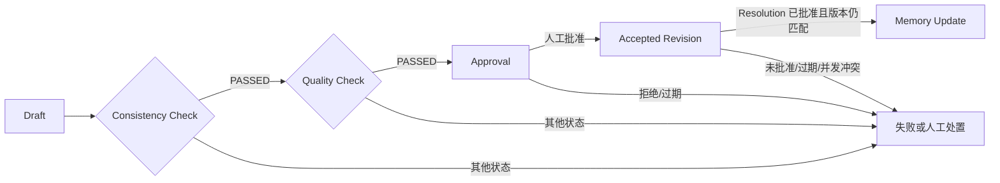

# Canon、一致性与质量评估架构

## 范围与事实所有权

执行 14 只建立 Canon 元数据、结构性检查、质量状态和人工修复提案骨架，不保存创作正文，也不实现语义评分或自动修文。

| 数据 | 唯一拥有者 | Consistency / Quality 的边界 |
|---|---|---|
| Novel、World、Character 当前状态与 Revision | `creative` | 只经 `creative.public` 查询和申请新 Revision；禁止写 `creative_*` 表 |
| 跨域 Canon 约束、规范化时间线断言 | `consistency` | 保存版本、有效时间和来源引用，不复制世界或人物状态 |
| 检查运行、Finding、Resolution | `consistency` | 保存证据指针、检查器版本、actor、Workflow 和最终 Revision 引用 |
| Rubric schema、评估运行、维度结果 | `quality` | 只保存 schema/version 元数据和机器状态，不保存真实评分标准或权重 |
| Working/Session Memory | `memory` | 只有 Resolution 已应用后才能进入 Memory Update；Consistency 不写 Memory 表 |

`EvidenceProjection` 是可以删除并重建的只读指针投影。每条记录固定到 owner、entity、revision ID 和 revision version；权威事实仍由 Creative 保存。`TimelineEvent` 同样只是对权威事件/Revision 的规范化断言，不是第二份可独立修改的状态。

## Canon、时间线与依赖模型

- `CanonEntry` 使用 Level 1–4、逻辑 ID、递增版本、有效时间窗、来源引用和显式状态。
- Level 1 表示最高保护级别；修改当前 Level 1 Canon 若未显式授权，结构检查产生 blocker Finding。
- `TimelineEvent` 保存事件引用、发生时间、序号、人物/世界状态引用和来源版本。
- `RuleConstraint` 与 `DependencyEdge` 只表达引用关系和解析状态，不保存规则正文。
- 批处理输入由 `ValidationBundle.cursor/next_cursor` 提供分页边界；本阶段不声称支持百万字扫描性能。

## Validator Registry 与状态语义

Registry 固定提供一个 `structural@1.0.0` 检查器，并为 character、timeline、world rule、plot dependency、theme alignment 五类语义检查安装 Null 实现。缺失或 Null 检查器都返回 `NOT_CONFIGURED`，绝不返回伪通过。

结构检查只执行以下七类确定性规则：

1. 必填字段存在性；
2. 引用是否可解析；
3. 事件不得早于其前置事件；
4. 同一实体同一 mutex group 不得存在多个 current 状态；
5. 期望版本必须等于当前版本；
6. Level 1 Canon 当前值修改必须显式授权；
7. 依赖边必须已解析。

检查状态的聚合优先级为 `RUN_FAILED > FINDINGS > NOT_CONFIGURED > NOT_RUN > PASSED`。只要有检查失败、Finding、未配置或未运行，整个检查都不会被标为通过。

| 状态 | 含义 | 可否通过 Consistency Gate |
|---|---|---|
| `NOT_RUN` | 已建立运行或计划，但检查器尚未执行 | 否 |
| `NOT_CONFIGURED` | 对应检查器没有可用实现 | 否 |
| `RUN_FAILED` | 检查器执行异常；内部异常不会越过边界 | 否 |
| `FINDINGS` | 检查真实完成并产生一个或多个 Finding | 否 |
| `PASSED` | 所请求检查器真实执行且没有 Finding | 是 |

Quality 使用同样诚实的 `NOT_RUN`、`NOT_CONFIGURED`、`RUN_FAILED`、`FAILED`、`PASSED` 状态。默认 `StructuralQualityEvaluator` 只评价上游结构一致性；`NullQualityEvaluator` 明确返回未配置。Rubric 仅含 key、版本、schema version 和 dimension keys。

## 人工 Resolution 应用协议

```mermaid
sequenceDiagram
  participant Actor
  participant Consistency
  participant Repository
  participant Creative as Creative public Revision use case

  Actor->>Consistency: propose(findings, target@expected_version, impacts)
  Consistency->>Repository: save PROPOSED + audit/outbox metadata
  Actor->>Consistency: decide(APPROVE, proposal_version)
  Consistency->>Repository: optimistic transition to APPROVED
  Actor->>Consistency: apply(expected proposal_version)
  Consistency->>Creative: read current target version
  alt target version changed
    Consistency-->>Actor: TargetVersionConflict(current_version)
  else target unchanged
    Consistency->>Repository: claim APPROVED -> APPLYING
    Consistency->>Creative: apply through owner use case
    Creative-->>Consistency: new accepted Revision reference/version
    Consistency->>Repository: APPLIED + resolve Findings + outbox
  end
```

`requires_approval` 永远为 true。决定操作需要 `APPROVAL_DECIDE`，应用操作需要 `PROJECT_WRITE`；二者都重新执行 Workspace/Project 授权。应用前先读取事实模块当前版本，再通过提案版本锁 claim；因此过期 Proposal 和两个并发应用者都不能覆盖新状态。Creative 自身仍执行容器乐观锁并生成新 Proposal/Accepted Revision，Consistency 不拥有修复文本，也没有私表写权限。

## Workflow 门禁



`canon_quality_gate@1` 的顺序固定为 Draft → Consistency Check → Quality Check → Approval → Accepted Revision → Memory Update。Approval Step 仍由 Workflows 模块拥有；Accepted Revision Step 会再次验证 Consistency Resolution 的持久状态。Workflow 批准不能替代 Resolution 的授权决定，Resolution 未处于 `APPROVED` 时不会产生新 Creative Revision，Memory Update 也只接受 `APPLIED` 引用。

## 持久化与事件

Alembic `0010_consistency_quality` 新增六张 Consistency 表和三张 Quality 表。Canon 提案、检查完成、Resolution 提案/决定/应用及 Quality 运行开始/完成通过既有事务 Outbox 写入版本化技术事件。事件 payload 只包含 schema、actor 和结果引用/版本等元数据，不包含创作内容。

所有仓储读取同时过滤 Workspace、Project 和对象 ID。SQL Resolution 决定、claim 与完成使用行锁和整数版本；Finding 只在 Resolution 成功保存最终 Revision 后变为 resolved。投影可按 Workspace/Project 整体替换并从权威公开读端口重建。

## 明确未实现

- 没有主题、人物心理、世界规则或文本质量的语义判断；五类语义 Validator 均为 Null。
- 没有评分权重、创作标准、修复文本、Prompt 或真实模型调用。
- 没有 Canon 自动生效、正文自动修改或自动 Memory 写入。
- REST/OpenAPI/SSE 与 Studio 页面留给执行 16–20；执行 15 只能读取公开结果和事件，不能绕过本阶段人工门禁。
