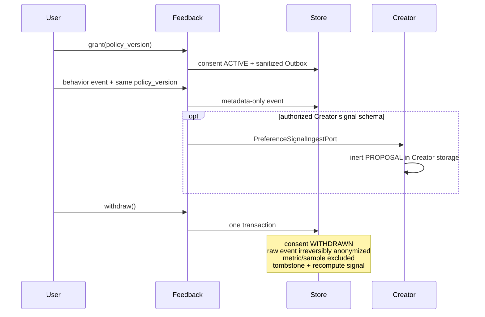
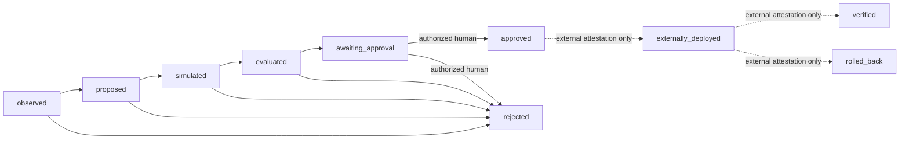

# 反馈、指标与受控进化架构

## 范围与所有权

执行 15 建立可观察、可诊断、可模拟、必须人工决定的安全闭环。它不读取或保存小说正文、Prompt、密钥或真实作者画像，也没有修改配置、文件、Git、数据库结构或部署环境的能力。

| 数据或动作 | 唯一拥有者 | 边界 |
|---|---|---|
| 同意、反馈事件、指标、诊断、实验 | `feedback` | 只保存结构化技术代码、数值和不透明引用 |
| Creator Preference/Decision 信号 | `creative` | Feedback 只调用 `PreferenceSignalIngestPort`；Creator 不导入 Feedback 仓储 |
| 改进观察、分析版本、模拟证据、人工决定 | `evolution` | 只保存 Proposal 和审计轨迹，不持有任何执行变更的 Port |
| 项目状态与授权 | `projects` / `identity` | 每次读写重新执行 Workspace/Project scope 与 RBAC 检查 |

## 隐私默认值与撤回协议

反馈来源固定为 `user`、`system`、`creative-result`、`behavior-consented`。前三类是显式结构化输入；行为采集默认关闭，只有当前用户在当前 Workspace/Project 下存在 ACTIVE 同意，并且事件携带的策略版本完全一致时才可写入。

撤回事务执行以下固定动作：

1. 把当前同意改为 `WITHDRAWN`，保留 actor、策略版本、授予时间和撤回时间作为不含行为正文的同意证据。
2. 对该 actor 的 ACTIVE 行为事件清除 actor、signal code、数值、来源引用、consent 引用和 Creator signal 引用，只保留匿名事件 ID、来源类型、schema 版本、时间与 `ANONYMIZED` 状态。
3. 把所有直接派生的 MetricPoint 和 ExperimentSample 立即设为 `included=false` 并写入 `tombstoned_at`。
4. 为 MetricPoint 写 `RECOMPUTE` tombstone，为实验样本和 Creator 派生信号写 `EXCLUDE` tombstone；事务 Outbox 只发布策略版本和 `recompute_required`，不包含行为正文。
5. 撤回完成后不存在 ACTIVE 同意，后续行为采集立即失败关闭；重新采集必须产生新的显式同意记录。

## 指标注册表

每个 `MetricDefinition` 固定名称、版本、单位、有限维度词表、保留天数和敏感级别。维度最多四个，每个维度最多 32 个预注册值；`actor_id`、`user_id`、`project_id`、`object_id`、`request_id`、`correlation_id`、`prompt`、`content`、`secret` 等高基数或敏感标签被拒绝。MetricPoint 的维度集合和值必须与注册版本完全一致，数值必须有限。

首期内置技术指标：

| 名称 | 单位 | 有限维度 | 覆盖 |
|---|---|---|---|
| `agent.outcome` | count | status=success/failure | Agent 成功/失败 |
| `agent.latency_ms` | milliseconds | 无 | Agent 延迟 |
| `agent.budget_utilization` | ratio | resource=steps/model-calls/tool-calls/time/tokens | Agent 预算 |
| `memory.recall_status` | count | status=hit/miss/not-configured/failure | Memory 召回状态 |
| `workflow.outcome` | count | status=completed/failed/recovered | Workflow 完成、失败、恢复 |
| `runtime.health` | count | component=api/worker；status=healthy/degraded/unhealthy | API/Worker 健康 |

注册表和采集命令没有正文、原始 Prompt 或密钥字段。来源只允许不透明技术 URI；Workspace、Project 或对象 ID 不进入指标 labels。

## System Doctor 与实验

`SystemDoctor` 只接收已纳入统计的 MetricPoint，并以版本化的确定性阈值规则产生 `DiagnosticFinding`。当前规则覆盖 Agent 失败/高延迟/预算耗尽、Memory 召回失败、Workflow 失败和 API/Worker 不健康。相同 point + rule/version 产生确定性 Finding ID。Doctor 不持有模型路由、Prompt、Workflow、配置或部署写 Port。

实验协议保存 hypothesis code、primary metric、`technical-smoke` sample scope、起止时间、至少两个 variant、配置不透明引用、停止条件、状态和 result code。只有已注册指标可以作为 primary metric；本阶段拒绝作者内容或真实行为画像样本。生命周期为 `PLANNED -> RUNNING -> COMPLETED/STOPPED`，结果仍是技术代码而非创作评分正文。

## Evolution 组件与状态机

Evolution 的组合根显式装配八个边界：Observer、Analyzer、Planner、SimulationEnvironment、VersionManager、SafetyController、EvolutionMemory，以及对外的 Proposal Service。默认实现全部确定性、离线、无副作用。

应用服务的自治路径最多到 `awaiting_approval`。只有具备 `approval:decide`、actor kind 为 USER、且不是 Proposal 请求者的主体可以把它改为 `approved` 或 `rejected`。状态机描述外部部署后的事实状态，但本阶段不公开部署、Git、Shell、文件写入或 schema 迁移方法，因此系统不能自行进入 `externally_deployed`。

每个 Proposal 保存 DiagnosticFinding ID、完整输入引用、Observer/Analyzer/Planner/Simulation/Version 版本、Safety 策略与规则、变更不透明引用、模拟证据、evaluation code、批准 actor 和 rollback reference。每次状态变化另外追加 `EvolutionAuditEntry` 和事务 Outbox。

## 不可变安全规则

`ImmutableSafetyController@evolution-safety-v1` 固定拒绝：

- `change-ownership`：改变所有权；
- `disable-safety`：关闭安全控制；
- `elevate-permission`：提升权限；
- `bypass-approval`：绕过人工批准；
- `auto-commit-code`：自动提交代码；
- `auto-deploy`：自动部署；
- `unmigrated-schema`：未经迁移修改 schema。

拒绝仍会持久化为 `REJECTED` Proposal，并记录命中的不可变 rule code；它不会被转换为异常后丢失审计证据。

## 持久化

Alembic `0011_feedback_evolution` 新增十一张表：九张 Feedback 表（同意、事件、指标定义、指标点、诊断、实验、变体、样本、tombstone）和两张 Evolution 表（Proposal、Audit）。所有跨业务聚合只保存 UUID 或不透明引用；事务变化与既有 Outbox 原子提交。所有读取按 Workspace、Project 和对象 ID 过滤。

## 明确未实现

- 没有行为 SDK、自动埋点、真实作者画像、正文标签或生产实验流量分配。
- 没有基于反馈自动修改 Prompt、Agent、Memory 权重、Workflow 或配置。
- 没有代码生成、文件写入、Shell、Git、自动迁移、部署或外部执行端口。
- `externally_deployed`、`verified`、`rolled_back` 只存在于完整状态协议中；当前公开服务没有进入这些状态的用例。
- REST/OpenAPI/SSE 和 Studio 页面按执行 16–20 提供。
