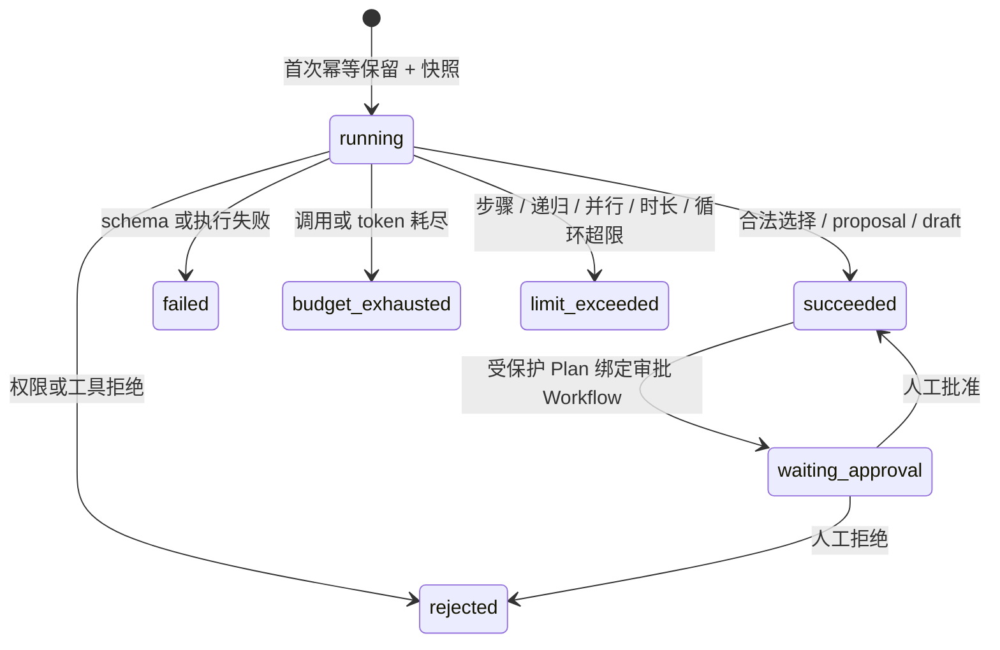

# 执行 10 交接

## 状态

**PASS**

无状态 Agent Runtime、Director/Master 总控契约、版本化上下文快照、严格执行限额、幂等用量结算和 Workflow 人工关卡已经形成真实可导入、可迁移、可测试的离线纵向链路。技术目标可由 Fake Director 类型化选择 `framework_smoke@1`，Workflow Worker 的技术步骤再调用 Fake Quality Agent、Fake Model 与显式授权的 Fake Tool；状态、版本、事件和关联 ID 均持久化在 PostgreSQL。

- 架构与状态边界：[`../architecture/10-agent-runtime.md`](../architecture/10-agent-runtime.md)
- 运行、诊断与回退：[`../runbooks/agent-runtime.md`](../runbooks/agent-runtime.md)

本阶段没有写 Agent Prompt、人设、专业知识、创作规则或真实业务内容；没有接入真实模型、远程插件、Shell、任意网络/文件能力，也没有执行 commit、push、镜像推送或部署。既有未提交文件均保留。

## 前置与范围确认

- 仓库根由直接存在的 `改进资料.txt` 与 `执行.txt` 判定为 `D:\搭建`，没有创建第二层仓库。
- 已读取 `执行/00_执行总览与使用规则.md`、`执行/10_Agent运行时与总控编排.md` 与 `docs/handoffs/09.md`；执行 09 状态为 `PASS`。
- 第 09 步前置门禁曾在本阶段开始时复跑通过：194 项 Python 测试、5 项 Vitest，覆盖率 100%，格式、lint、类型和依赖边界均通过。
- 仓库没有 `.codegraph/`，因此按执行规则使用普通代码检索。
- 范围止于 Agent 注册、单次执行、总控选择、持久证据和审批编排；没有提前实现执行 11 的知识采集、执行 12 的记忆或执行 13 的创作领域逻辑。

## 本阶段变更

### Agent 领域与公共端口

- 新增 `modules/agents`，公开 `AgentDescriptor`、`AgentInvocation`、`AgentExecution`、`AgentRun`、`AgentContextSnapshot`、`AgentRunEvent`、结果类型、稳定错误码和 `AgentBudget`。
- 公开 `AgentRegistry`、`AgentExecutor`、`AgentSupervisor`、`AgentRepository` 与 `AgentMetrics` 端口；默认提供确定性的内存 Registry/Metrics、`DefaultAgentSupervisor` 与 `FakeAgentExecutor`。
- 注册七个 `1.0.0` 无内容描述符：Director、Research、World、Character、Writer、Editor、Quality。描述符只含能力名、object schema、允许工具、模型策略引用、Prompt 元数据引用及校验和、预算上限，不含 Prompt 正文。
- Director 只能返回 `WorkflowSelection` 或 `WorkflowPlanProposal`；其他 Agent 只能返回 proposal/draft reference。当前 Director 的选择 allowlist 仅允许 `framework_smoke@1`。
- 输入、输出和引用均在 Supervisor/Master 边界校验；未知 Agent、错误 schema、循环路径、越权 Tool、未固定 Tool 版本、缺失权限、预算扩张和执行异常全部失败关闭并保存稳定终态。

### 总控、Workflow 与人工关卡

- `MasterOrchestrator` 只提交可信目标引用、调用 Director、验证类型化选择并向 `WorkflowService` 提交固定定义；Workflow Engine 仍是步骤、重试、审批和长期状态的唯一所有者。
- `WorkflowSelection` 启动既有 `framework_smoke@1`。Worker 的 `pass-token` 技术步骤由 `AgentWorkflowExecutor` 调用 Quality Agent，后者只经公共 `ModelGateway` 与带可信 Task `ToolGrant` 的 `ToolGateway` 使用 Fake 能力。
- `WorkflowPlanProposal` 必须列出 Canon、所有权、权限、发布或删除等受保护操作，并固定 `approval_required=true`；Master 只能提交 `agent_plan_review@1` 的 Workflow 人工审批步骤，不执行提案里的受保护变更。
- 人工批准/拒绝会投影回 Agent Run。审批结算对相同审批终态幂等，但会明确拒绝从未进入审批流程的普通成功/失败 Run，不能借终态绕过状态机。

### 限额、快照与持久化

平台、Descriptor 与调用方限额取逐项最小值，调用方只能收窄：

| 限制 | 默认硬上限 |
|---|---:|
| 最大步骤 | 16 |
| 最大递归深度 | 3 |
| 最大并行数 | 4 |
| 总时长 | 30 秒 |
| 模型与工具总调用 | 8 |
| 总 token | 2,048 |

`framework_smoke` 的 Quality Agent 再收窄为 2 步、深度 1、并行 1、10 秒、2 次调用和 64 token。Agent 限额不能重置或替代模型、工具、Workspace、Task 或 Workflow 已有门禁。

- Alembic `0006_agent_runtime` 新增 `accos.agent_context_snapshots`、`agent_runs` 与 `agent_run_events`。
- Context Snapshot 固定 Agent、模型策略、Prompt 元数据、Tool、权限和规范化输入摘要版本；不保存 Prompt 或输入正文，并由数据库 trigger 禁止 UPDATE/DELETE。
- Agent Run 保存 Workspace/Project scope、状态、尝试、Workflow/结果引用、一次模型/工具/token 结算和稳定错误码。Workspace 级幂等键保证同请求重投不产生第二个业务结果或第二次用量。
- Run Event 使用每 Run 递增 sequence，并与事务 Outbox 一起追加；事件表同样由数据库 trigger 保护为 append-only。
- composition root 注册 Agent services，并让 API/Worker 共享公共契约、但继续使用既有独立 consumer 数据库/事件循环边界。

## Agent 状态图

所有终态与已经完成的审批决定对相同幂等请求稳定返回；不同请求摘要、不同 Workflow 绑定或非法状态迁移会返回明确错误。

## 主要文件

- `services/core/src/accos/modules/agents/`：领域契约、内置描述符、端口、Supervisor、Master、Workflow executor 与 Fake executor。
- `services/core/src/accos/adapters/agents/`：内存/SQL Agent repository、ORM rows、事件与 Outbox 事务写入。
- `services/core/migrations/versions/0006_agent_runtime.py` 与 `services/core/migrations/env.py`：结构迁移和 metadata 注册。
- `services/core/src/accos/composition/root.py`、`composition/__init__.py`：默认离线组合与 Worker 链路。
- `services/core/tests/test_agents.py`、`test_persistence.py`、`test_adapters_composition.py`：契约、反向安全、状态机、持久化、迁移与纵向验收。
- `docs/architecture/10-agent-runtime.md`、`docs/runbooks/agent-runtime.md`，以及架构导览、数据所有权、数据库、Workflow、模型/工具和项目运行手册的 revision/边界更新。

## 验证证据

### 最终统一门禁

使用仓库锁定的 Node 22.23.2、uv 0.12.7、Python 3.12.14 与 pnpm 11.25.0 执行 `node scripts/toolchain.mjs check`：**PASS**。

- Ruff format：119 个文件通过；Prettier：通过。
- Ruff lint、ESLint：通过。
- Import Linter：分析 126 个文件、600 条依赖；2 个契约 kept、0 broken。
- 自定义 Python import boundary 与 dependency-cruiser：通过。
- mypy strict：111 个源/测试/脚本文件无问题；TypeScript `tsc --noEmit`：通过。
- pytest：**211 项通过**；5,355 statements、840 branches，缺失 0，覆盖率 **100%**。
- Vitest：2 个文件、**5 项测试通过**。
- 仅有 Starlette/AnyIO 第三方弃用警告和当前受限终端无法写根 `.pytest_cache` 的缓存警告；测试临时目录使用已忽略的 `.tmp-pytest10`，不影响源码或验收。

### 数据库与纵向验收

- 随机空 PostgreSQL 测试库执行 `upgrade head`，以及 `upgrade -> downgrade base -> upgrade` 往返通过；外键、检查约束、Workspace scope 与 append-only trigger 均有反测。
- 开发库已执行 `upgrade head`，当前为 `0006_agent_runtime (head)`；`alembic check` 返回 `No new upgrade operations detected.`。
- 开发库行数：Context Snapshot、Agent Run、Agent Event、Model Usage、Tool Call 全部为 **0**；所有纵向调用只发生在自动创建并清理的随机测试库。
- 真实 PostgreSQL 纵向测试验证：技术目标 -> Director 选择 `framework_smoke` -> Worker/Quality Agent -> Fake Model/Tool -> Workflow `succeeded`，共享 Workflow、Task 与 correlation ID。
- 同 Director/Quality 幂等重投复用首次 Run/结果/快照，模型和工具账本各仅一条；Agent 状态/用量只结算一次。
- 上下文重放能读取完全相同的 Agent、模型策略、Prompt 元数据、Tool、权限和输入摘要版本；跨 Workspace 查询返回空或明确拒绝。
- 受保护 Plan 进入 `waiting_approval`，人工拒绝后 Workflow 失败且 Agent 为 `rejected`；重复拒绝幂等，错误 Workspace 和普通非审批 Run 均不能结算审批。

## 已知限制与执行 11 输入

- 本阶段只有 Python 应用/Worker 契约；Agent REST/OpenAPI 资源路由和 UI 按执行 16–20 暴露。
- 默认只有确定性 Fake Agent/Fake Model/Fake Tool，没有真实 Prompt、真实 Provider SDK、凭据、网络检索、远程插件或实际领域产物。
- Descriptor 当前是版本化代码配置，不是可动态创建的数据库实体；不存在 Agent 自由繁殖、自治组织、自改代码、自改权限或自行部署。
- Agent metrics 当前是进程内 sink，持久事实以 Agent Run/Event、Workflow、Outbox 与调用账本为准；统一遥测后端留到执行 22。
- 本阶段 Context Snapshot 只固定输入摘要和元数据引用。执行 11 的知识模块必须通过自己的公共端口提供可追溯文档/检索引用，不得让 Agent 直接访问知识表、向量 SDK 或对象存储。
- 执行 11 应复用 Agent、Model、Tool、Workflow 与 Project 的公开契约，不能向本阶段的 Agent 描述符填充研究 Prompt 或真实知识内容。

## 回滚

1. 停止 API/Worker，确认没有进行中的 Agent/Workflow 调用，并备份三张 Agent 表及关联 Workflow、Outbox、Model/Tool/Audit 记录。
2. 执行 `uv run --frozen alembic -c services/core/alembic.ini downgrade 0005_model_tool_gateways`；该操作删除三张 Agent 表，保留执行 09 的模型/工具账本和 Workflow 权限快照。
3. 恢复本交接列出的 agents 模块/适配器、composition、migration env、测试和文档变更。当前仓库没有提交基线，不能依赖 commit 自动回滚。
4. 重新运行执行 09 统一门禁、`alembic check` 与 `framework_smoke`，确认数据库 revision 为 `0005_model_tool_gateways`。

执行 11 前读取 `执行/00_执行总览与使用规则.md`、`执行/11_知识采集检索与研究骨架.md` 和本交接；不得修改本文件的 PASS 状态。
