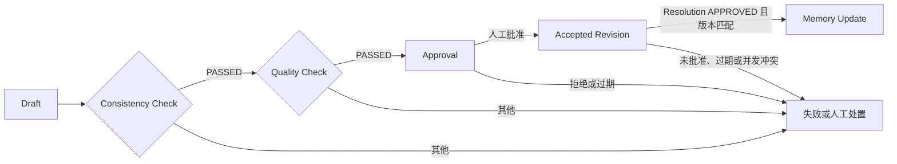

# 执行 14 交接

## 状态

**PASS**

Canon/时间线/只读证据投影、七类确定性一致性 Finding、schema-only 质量评估、人工 Resolution 和固定 Workflow 门禁已落地。Creative 继续唯一拥有 Novel/World/Character 的当前状态与 Revision；Consistency 不写 Creative 私表，Quality 不把未运行、未配置或运行失败伪装成通过。

- 架构与状态语义：[`../architecture/14-consistency-quality.md`](../architecture/14-consistency-quality.md)
- 运行、诊断与回退：[`../runbooks/consistency-quality.md`](../runbooks/consistency-quality.md)

本阶段没有写入小说、世界、人物、Canon 正文、评分标准、修复文本、Prompt 或演示数据；没有接入真实模型、外部服务或付费调用；未执行 commit、push、镜像推送或部署。第 13 步 PASS 文档未修改。

## 前置与范围确认

- 仓库根由直接存在的 `改进资料.txt` 与 `执行.txt` 确认为 `D:\搭建`，没有创建第二层仓库。
- 已读取 `执行/00_执行总览与使用规则.md`、`执行/14_Canon一致性与质量评估.md` 和 `docs/handoffs/13.md`。
- 仓库不存在 `.codegraph/`，按规则使用普通源码检索。
- 实施前第 13 步基线为 236 项 Python 测试、5 项 Vitest 与 100% 覆盖率通过。
- 范围止于 Consistency/Quality 骨架、确定性规则、持久状态和 Workflow 门禁；没有提前实现执行 15 的 Feedback、指标、实验或 Evolution。

## 本阶段变更

### Canon、时间线与确定性检查

- 新增 `modules/consistency` 的 Canon Level 1–4、版本/有效时间/来源/状态，TimelineEvent、RuleConstraint、DependencyEdge、EvidenceProjection、Finding 与 Resolution 契约。
- `StructuralValidator@1.0.0` 覆盖必填、引用、时间顺序、互斥状态、版本冲突、Level 1 修改保护和未解析依赖七类确定性 Finding。
- Validator Registry 为 character、timeline、world rule、plot dependency、theme alignment 五类语义检查安装 Null 端口；检查器缺失、Null 或异常分别保持明确状态。
- `ValidationBundle` 提供 cursor/next_cursor 批处理边界，但没有百万字性能声明。

### 人工 Resolution 与事实模块边界

- Resolution 保存 Finding、strategy code、target@expected_version、影响引用、Workflow、请求/批准/应用 actor、结果 Revision 与整数乐观锁。
- `requires_approval` 固定为 true；决定需要 `APPROVAL_DECIDE`，应用需要 `PROJECT_WRITE`。归档项目、跨 Workspace/Project 读取和缺失 Finding 均失败关闭。
- 应用前重新调用 Creative 公共 Revision 服务读取当前版本；过期 target 返回 `current_version`，Proposal 版本竞争由 claim 拒绝。
- Creative 公共用例创建 metadata-only 新 Proposal 并执行既有容器审批切换；Consistency 只持有最终 Revision 引用/版本，不导入 Creative persistence，也不修改其私表。
- ProjectionRebuilder 只接受权威公开读端口，按 Workspace/Project 整体替换 pointer-only 投影；测试证明投影可删除并确定性重建。

### Quality 与诚实状态

- 新增 `RubricVersion`、`EvaluationRun`、`ScoreDimension`、`QualityResult` 与 evaluator/repository Port。
- Rubric 只允许 schema version 和唯一 dimension keys，没有标准正文、权重或主题判断。
- 默认 `StructuralQualityEvaluator` 只映射上游一致性结果；`NullQualityEvaluator` 返回 `NOT_CONFIGURED`；未知 evaluator 异常转换为稳定 `RUN_FAILED`。

检查与评估状态不能折叠：

| 层 | 状态 | 语义 | 可通过门禁 |
|---|---|---|---|
| Consistency | `NOT_RUN` | 尚未执行 | 否 |
| Consistency | `NOT_CONFIGURED` | 检查器未配置 | 否 |
| Consistency | `RUN_FAILED` | 执行异常 | 否 |
| Consistency | `FINDINGS` | 真实执行并发现问题 | 否 |
| Consistency | `PASSED` | 真实执行且无 Finding | 是 |
| Quality | `NOT_RUN` / `NOT_CONFIGURED` / `RUN_FAILED` / `FAILED` | 未完成、不可用或未通过 | 否 |
| Quality | `PASSED` | 当前 evaluator 真实通过 | 是 |

Consistency 聚合优先级固定为 `RUN_FAILED > FINDINGS > NOT_CONFIGURED > NOT_RUN > PASSED`。

### Workflow 门禁

- 新增 `canon_quality_gate@1`，顺序严格为 Draft → Consistency Check → Quality Check → Approval → Accepted Revision → Memory Update。
- Consistency/Quality 不是 `PASSED` 时 Workflow Step 返回永久失败；无安全上下文、无 project、非法 gate/reference 都失败关闭。
- Approval Step 由 Workflows 模块持久化；Accepted Revision 仍重新检查独立的 Resolution 授权和版本。Workflow 批准不能替代目标模块授权。
- Memory Update 只接受已应用 Resolution 引用，并重新读取其 `APPLIED` 状态；本阶段不写 Memory 内容。

### 持久化、迁移与组合根

- Alembic `0010_consistency_quality` 新增六张 Consistency 表：`consistency_canon_entries`、`consistency_timeline_events`、`consistency_check_runs`、`consistency_findings`、`consistency_resolution_proposals`、`consistency_evidence_projection`。
- 新增三张 Quality 表：`quality_rubric_versions`、`quality_evaluation_runs`、`quality_results`。
- Canon 提案、检查完成、Resolution 提案/决定/应用和 Quality 运行开始/完成与既有事务 Outbox 原子追加；事件不含创作内容。
- 组合根为 API 与独立 Workflow consumer 分别装配 SQL 仓储、Creative 公共 Revision adapter、默认 Validator Registry、Structural Quality evaluator 和 `PersistedCanonQualityGate`。
- ORM 仅存在于 `adapters/consistency` 与 `adapters/quality`；公开包不暴露 SQLAlchemy 类型。

## 验证证据

### 最终统一门禁

使用仓库锁定的 Node 22.23.2、uv 0.12.7、Python 3.12.14 与 pnpm 11.25.0 执行完整门禁：**PASS**。受限会话中的 pytest 显式使用工作区 basetemp 并关闭默认 cache provider，不影响源码或验收。

- Ruff format 与 lint：通过。
- Import Linter：178 个文件、932 条依赖，2 个契约 kept、0 broken；自定义 Python import boundary 通过。
- mypy strict：167 个源/测试/脚本文件无问题。
- pytest：**242 项通过**；9,281 statements、1,398 branches，缺失 0，覆盖率 **100%**。
- Prettier、ESLint、TypeScript、dependency-cruiser：通过。
- Vitest：2 个文件、**5 项测试通过**。
- 仅有 Starlette/AnyIO 第三方弃用警告，不影响源码或验收。

### 迁移、持久化与反向用例

- 随机空 PostgreSQL 测试库执行 `upgrade head`、重复 upgrade、`upgrade -> downgrade base -> upgrade` 与 `alembic check`；迁移、ORM metadata、命名外键及 revision 断言通过。
- SQL 仓储真实验证 Canon/Timeline、检查报告/Finding、Resolution decide/claim/finish、Finding resolved、投影替换、Rubric/Evaluation/Result、Outbox 原子写入、Workspace scope、重复写入和乐观并发。
- 反向用例覆盖时间倒置、无效引用、互斥状态、版本冲突、Level 1 非法修改、未解析依赖、重复检查器、检查异常、非法状态组合、未批准 Resolution、过期 target、并发 apply、归档项目、权限拒绝和跨项目不可见。
- Workflow 用例覆盖固定顺序、Consistency/Quality 阻断、缺失上下文、非法引用、未应用 Resolution 禁止 Memory Update，以及 Accepted Revision 必须调用持久化 Resolution 服务。
- Creative adapter 用例证明新 Revision 只经公开 application 用例生成，并覆盖容器竞争、target 过期与错误 target reference。
- 开发库已升级到 `0010_consistency_quality (head)`；`alembic check` 返回 `No new upgrade operations detected.`。九张第 14 步表均为 0 行。

## 已知限制与执行 15 输入

- 五类语义 Consistency Validator 与真实创作质量 evaluator 均未配置；`NOT_CONFIGURED` 是真实预期状态，不代表通过。
- Rubric 没有标准正文、分数权重或阈值；默认结构质量结果只说明上游一致性门是否通过。
- ProjectionRebuilder 的公开读 Port 与可重建仓储已落地；具体事件订阅/批处理调度由后续 API/Worker 接线选择，不能改为跨表读取。
- Resolution claim 后若目标模块异常会保持 `APPLYING`，不会产生成功状态或 Memory Update；后续运维/API 应暴露人工诊断与恢复入口，不得自动重放未知副作用。
- 当前没有 Consistency/Quality REST/OpenAPI/SSE/Studio 页面，按执行 16–20 暴露。
- 执行 15 可消费 Finding、QualityResult 和版本化事件来建立 Feedback/指标，但不得从反馈自动修改 Canon、Creative、Rubric、权限、代码或部署；改进仍必须形成可审计提案并人工批准。

## 回滚

1. 停止 API/Worker，备份第 14 步九张表、相关 Audit 与 Outbox。
2. 确认无需保留第 14 步状态后执行 `uv run --frozen alembic -c services/core/alembic.ini downgrade 0009_creative_domains`；只删除 Consistency/Quality 表，保留 Creative。
3. 恢复本交接列出的 consistency、quality、Creative Revision adapter/公开契约、组合根、迁移环境、测试和文档变更。当前仓库没有提交基线，不能依赖 commit 自动回滚。
4. 重新运行第 13 步统一门禁与 `alembic check`，确认 revision 为 `0009_creative_domains`。

执行 15 前读取 `执行/00_执行总览与使用规则.md`、`执行/15_反馈指标与受控进化闭环.md` 和本交接；不得修改本文件或第 13 步 PASS 状态。
