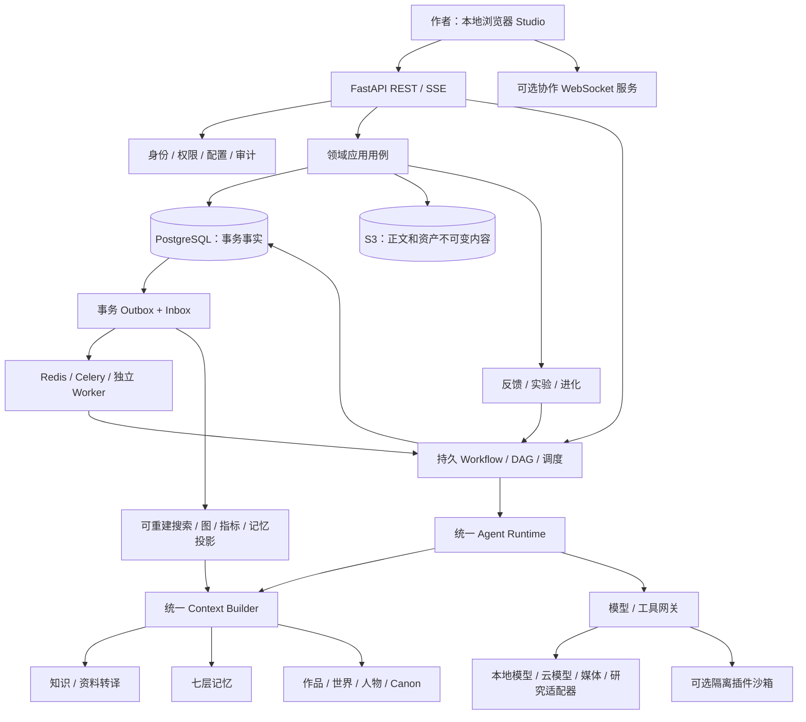

# 目标架构与运行契约

## 1. 保持一个产品、一套调度、一份事实

单体是部署单元，模块是代码/数据边界。新增协作服务和沙箱进程是协议/隔离所需，不是全项目微服务化。保留锁定的 Python 3.12.14、Node 22.23.2、Next 16.3.4 等现行版本；只因新增依赖确实不兼容时做最小升级并记录，不能为了“最新”全面换栈。

## 2. 唯一模块归属与代码落点

后端根路径均为 `services/core/src/accos/`。现有 `creative/novel.py`、`world.py` 等继续作为公开应用门面；新增子文件，不同时创建同名目录和文件，不搬出第二套 `backend/`。

| 所有者 | 负责的事实/行为 | 实施路径 |
|---|---|---|
| identity | 用户、本地会话、工作区、成员、授权、审批策略、consent权限 | `modules/identity`、`adapters/identity` |
| projects | 项目、Artifact、工作副本、不可变Revision、分支指针 | `modules/projects`、`adapters/projects` |
| assets | 内容blob、上传/下载、媒体原件、hash、扫描、保留 | `modules/assets`、`adapters/assets` |
| models | Provider/模型能力与路由、Prompt版本、结构输出、预算账本 | `modules/models/{application,prompts,registry,budgets}.py`、`adapters/models` |
| tools | 工具/插件注册、权限、manifest、调用与沙箱代理 | `modules/tools`、`adapters/tools`、`adapters/sandbox` |
| workflows | DAG、节点依赖、Run/Step/Task、调度、审批、补偿、提交协调 | `modules/workflows`、`adapters/workflows` |
| agents | 角色任务协议、Planner/Executor/Supervisor、有限会议、技能画像 | `modules/agents`；状态仍由Workflow调度 |
| knowledge | 来源、解析、知识节点、转译组件、类型适用条件、引用、研究 | `modules/knowledge/{application,translation,research}.py`、`adapters/knowledge` |
| memory | 七层记忆、有效时间、来源、授权、压缩、召回、**唯一ContextBuilder** | `modules/memory`、`adapters/memory` |
| creative.novel | 创意/主题、类型融合、作品结构、故事线/场景、正文计划 | `creative/{novel,genre,planning,narrative}.py` |
| creative.world | 规则、文明、地理、政治经济科技文化、历史和模拟候选 | `creative/{world,world_components,simulation}.py` |
| creative.character | DNA、心理/欲望/创伤、动态关系、成长、知识可见性、行为候选 | `creative/{character,psychology,relationships}.py` |
| creative.creator | 可撤回的作者偏好、风格、审美、决策、成长模型 | `creative/{creator,creator_learning}.py` |
| consistency | 跨域Canon约束、证据投影、Finding、影响分析、修复提案 | `modules/consistency` |
| quality | rubric、语义/结构评价、编辑委员会、读者模拟、基准结果 | `modules/quality`；不拥有正文 |
| feedback/evolution | 信号/指标、诊断、实验、改进候选、晋升和回滚记录 | 保留这两个模块；Creator不重复造一套 |
| ip（新增） | Universe、作品归属、共享资产/角色别名、跨作品Canon绑定 | `modules/ip`、`adapters/ip` |
| publishing（新增） | 定稿快照、排版/导出、发行包、改编包、导入任务 | `modules/publishing`、`adapters/publishing` |
| media（新增） | 图/音/视频/3D任务、分镜、角色视觉、跨媒介一致性 | `modules/media`、`adapters/media` |
| collaboration（新增） | 团队任务/评论、CRDT更新、在线态投影和文档快照 | `modules/collaboration`、`apps/collab`（自托管传输适配器） |
| ecosystem（新增） | 私有目录、知识/模板/Agent包、许可/贡献/订单/账本/信誉 | `modules/ecosystem`、`adapters/ecosystem` |
| extensions | 框架无关能力清单/端口/开关兼容层 | 不直接导入modules；在`adapters/extensions`和composition通过公开端口桥接真实应用，不维护第二份业务事实 |

API 继续位于 `entrypoints/api/v1/`；新增按资源划分的 router/schema，不继续把全部业务堆入 `stage17_router.py`。旧路径兼容，OpenAPI 与客户端同一步生成。

`composition/root.py` 应逐步拆为按模块的 factory，API 与 worker_factory 共享选择逻辑，分别创建符合其事件循环的连接。禁止只替换API侧Provider而Worker仍跑Fake。

## 3. 运行包与空内容

将可执行软件配置与用户内容分开：

- `services/core/resources/prompts/`：任务理解、提取、转译、规划、写作、审稿、事实提取、研究、学习、改进、改编等**通用协议Prompt**，版本化，变量必须显式声明；属于代码发布包。
- `services/core/resources/workflows/`：默认流程定义与schema，没有作品、人物、知识种子数据。
- `services/core/resources/rubrics/`：通用评分维度、尺度、缺证据规则，允许作者覆盖；不能空到质量评价无法工作。
- `content-packs/README.md` 与 schema：只给用户内容包格式/导入说明，具体知识、类型范例、风格样本保持空。
- 软件构建不能以“用户尚未提供内容”为由不实现正文读写、章节生成、解析器或Prompt编译。

## 4. 必须保持的不变量

1. 所有权、workspace/project/universe、分支、权限由服务端解析；不可相信模型返回的actor或授权字段。
2. 模块只写自己的表。跨模块事务由明确的应用协调器调用公开端口；禁止路由或Agent直接联写各模块ORM。
3. 事务事实在PG，blob在S3，正文版本记录包含资产版本和hash；Redis/向量/图/CRDT缓存不能成为不可恢复的唯一事实。
4. 任一产物指向明确输入版本。运行时不以“最新版本”替换已冻结输入；旧输入失效时标记STALE并生成新Run。
5. Mandatory context必须真正解析、授权、装入模型输入，并写ReadReceipt。哈希记录证明传入，不宣称能证明模型内部理解。
6. 预算必须包括输入、预留输出、工具往返、重试、fallback、并行候选与审稿。PG原子预留，成功结算、失败释放、未知外部结果冻结待对账。
7. 模型只产生候选。Schema通过不代表事实正确；Canon更新需要版本校验、合法审批策略与领域不变量。
8. Fake只用于独立测试/显式演示模式；真实功能不得以Fake降级为成功。不存在的引用必须报错。
9. 模型流与任务状态流分开：chunk只更新暂存草稿；最终完整输出落盘后才发completed。网页断线不取消任务，取消由受权API发起。
10. 每个外部副作用有稳定operation_key、provider_job_id和结果校验；供应商不支持幂等且结果未知时禁止盲重试并宣称exactly-once。
11. 数据引用不能变成执行指令。研究网页、上传文件、知识节点、市场包的文本不可授予工具权限；插件安装也必须重新授权。
12. 队列重复/乱序以事件ID、aggregate_version、inbox去重；投影落后显式显示lag，关键提交等待需要的版本。
13. consent撤回停止采集，派生样本和画像携带撤回标记、重算/排除；访问时重新授权，不能继续使用旧Context缓存。
14. 用户编辑与AI改写并发使用基线Revision和结构化Patch；冲突展示三方差异，不覆盖用户新编辑。
15. 长篇记忆不等于每章读全书。按依赖与作用域检索，并保留事实快照、卷摘要、事件因果和未回收伏笔。

## 5. 唯一能力状态模型

`implementation = absent | port_only | implemented`、`configuration = missing | configured`、`health = unknown | ready | degraded | unavailable`、`verification = untested | verified | failed`、`data = empty | sufficient | insufficient` 分开存储/展示。

例如“图片生成：已实现 / 待填Provider / 未测试”是诚实状态；“已启用”不等于功能已实现；“没有作者样本”不等于Creator模块缺代码。服务端 `/capabilities` 返回实现版本、缺少条件与配置链接，不只返回旧Feature Flag。

## 6. 新运行状态与调度

既有Run状态保持兼容；新增 `waiting_resource`、`waiting_configuration`、`waiting_budget`，节点新增 `blocked`、`skipped`、`stale`。新的失败码不塞进成功字符串。外部待结果是 `awaiting_external_result` 子状态，避免重复发送。

每个工作流版本定义节点的executor、输入/输出schema、depends_on、required_artifact_types、budget、approval_policy、retry/timeout和补偿。DAG不可有环；需要修订循环时每轮产生新iteration节点/子Run并受max_iterations限制，不能把任意Python/JS作为条件表达式。

定时任务由数据库Schedule + 租约协调器触发同一Workflow；唯一due claim防多Worker重复。应用不运行时显示上次运行/错过计划，下次启动按misfire_policy补跑或跳过，不声称关机后仍在后台工作。

## 7. 真实接入与自托管选择

- 文本模型：OpenAI Responses、OpenAI-compatible Chat Completions和本地端点三个适配器profile；各自映射实际协议、capability与错误。不得假定兼容端点支持所有能力。
- 专业编辑器：Tiptap/ProseMirror JSON作为可编辑文档格式，纯文本/Markdown为导出投影。协作使用Yjs与自托管传输，避免把商业托管服务设为本地基本功能的前提。
- 图：作品关系、时间线、知识来源使用PG投影；画布按子图分页和数量上限读取。
- 多模态和支付：真实适配器及业务状态机纳入构建，具体服务启用见07；无配置返回真实缺项，不生成假的结果。

Responses的流有独立文本增量和完成/错误事件，结构化输出也必须处理拒绝和未完成结果。[OpenAI流接口](https://developers.openai.com/api/docs/guides/streaming-responses)、[结构化输出](https://developers.openai.com/api/docs/guides/structured-outputs)。Yjs提供共享数据同步，应用仍需实现权限与持久化。[Yjs](https://docs.yjs.dev/)。pgvector支持非固定维度列，但索引仍需限定同维度模型集合，本方案选择generation隔离。[pgvector](https://github.com/pgvector/pgvector#can-i-store-vectors-with-different-dimensions-in-the-same-column)。Celery任务需要应用保证幂等，消息确认策略不能替代业务去重。[Celery任务说明](https://docs.celeryq.dev/en/stable/userguide/tasks.html)。这些引用用于协议选择，不代表本项目已验证。
