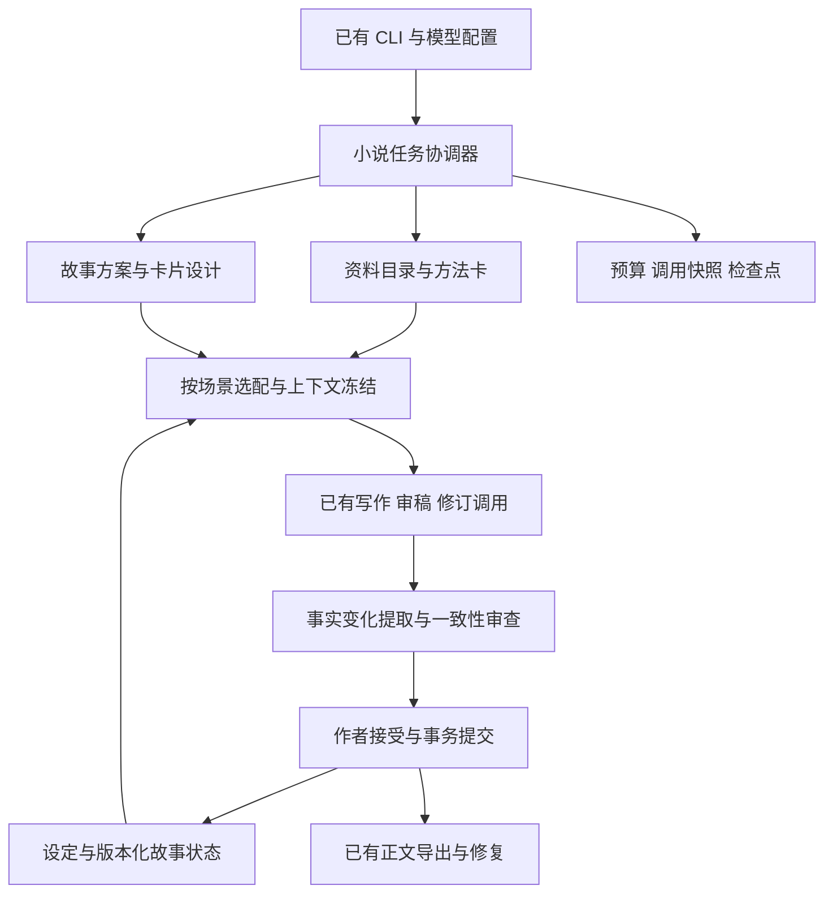

# 小说部分架构与复用设计 v1

2026-11-03。施工设计稿，待作者审阅。代码基线为 `95cb559100cd2e38f33de5bd276df81bdc6f6ff9`。

本稿细化《小说工作流设计_v1.md》，配套《04_小说部分实际搭建计划_v1.md》。作者本轮要求制作小说部分的实际搭建方案，并暂缓旧框架其他部分。本轮交付文档，工程里程碑均为 PLANNED。

## 1. 本次建成后的使用方式

作者录入创作目标，系统检索已登记资料，生成有区别的故事方案。作者选定方向后，系统生成必要的世界、人物、剧情、卷章和场景候选，解释需要作者决定的关键变化。在已确认范围与预算内完成选配、起草、审稿、修订，再展示正文及事实变化供接受。下一场读取已接受状态，暂停后可以恢复。

覆盖从零构思、继续创作、局部改写、早期剧情修改后的影响分析、资料增补与效果比较。初版交互沿用命令行，提供 Markdown 阅读导出。人物卡、剧情卡、场景卡由系统生成并允许作者编辑，作者无需预先填完全部字段。

本期范围固定为小说创作。旧框架中的登录与多用户、Web Studio、服务化部署、插件市场、出版平台对接、支付分成、多模态、IP开发和自动进化保留在原目录，暂缓施工。小说所需的作者确认、资料溯源和预算控制纳入本期。

## 2. 架构选择

沿用 `07_新框架_v0` 的 Python 3.11+、SQLite、模型适配器、草稿与运行记录。运行时优先标准库，测试沿用 pytest。持久文件继续放 `workspace/<project>/nw.db`，规则卡和小型测试夹具放 `fixtures/`。源资料从仓库相对路径读取，原文与运行数据分开。

采用一个本地进程协调串行创作任务。SQLite事务负责原子写入与竞争检测，模型调用在数据库事务外执行。跨进程重复启动必须被任务占用记录识别，不以“通常只有一个用户”为理由忽略并发。

三层故事信息仍是稳定设定、剧情状态、当前场景工作包。同一人物使用稳定ID关联三层，避免复制三份互不一致的人物资料。资料筛选另按“功能→板块→子项”执行，两套分层职责不同。

## 3. 旧成果复用矩阵

“直接沿用”表示在v0内继续调用现有接口；“适配复用”表示提取明确的数据约束或纯逻辑，并在v0实现依赖适配；“沿用设计”表示历史方案可指导新接口，但没有据此确认运行能力。此次静态核查未重跑历史测试。

| 旧位置 | 已核对能力及限制 | 本期复用方式 | 新方案落点 |
|---|---|---|---|
| `07/src/nw/llm/base.py`及两种真实适配器 | `LLMProvider.generate`与`GenResult`已有 | 直接沿用 | 所有模型任务共用相同适配器与密钥处理 |
| `07/src/nw/generation.py` | 写前存输入、写后存输出，已有write/review/revise | 直接沿用场景生成，增加任务级调用记录 | 非场景规划不伪造场景ID |
| `07/src/nw/store.py`、`schema.py` | 草稿不可变、接受指针、导出恢复、v1–v4迁移 | 直接沿用并扩展事务方法 | 接受正文与状态一次提交 |
| `07/src/nw/flow/engine.py` | 六节点、冻结输入、两轮修订、显式失败重试 | 复用写审改语义与调用函数 | 小说协调器提供新增设计及状态阶段 |
| `07/src/nw/context/base.py`、`registry.py` | 提供器接口与来源/理由字段 | 直接沿用提供器协议 | 新增story提供器、显式版本与知情裁剪 |
| `07/src/nw/experiments/ab.py` | 两版本记录、展示映射、选择与揭晓 | 沿用现有实验能力 | 校验共享基础输入后比较方法卡效果 |
| `01/services/core/src/accos/modules/projects/content_service.py` | 正文版本、并发更新与分支相关服务 | 适配复用其版本检查、修改影响和验收情形 | expected_revision、候选分支、早期修订传播 |
| `01/.../modules/workflows/` | 定义、依赖校验、调度与执行状态代码 | 适配冻结依赖、阻塞和恢复约束 | 顺序任务与依赖清单，使用SQLite存储 |
| `01/.../modules/knowledge/` | 摄取、标准化、分块、来源与检索接口 | 适配来源记录和确定性文本处理 | 小批源段登记、候选规则提炼与检索 |
| `01/.../modules/memory/` | 上下文构建、访问条件、记忆投影等结构 | 适配相关性/权限/投影边界 | 角色所知、读者所知、故事时间查询 |
| `01/.../modules/creative/common.py`及`application.py` | 人物/世界/小说记录的版本状态与确认服务 | 适配稳定身份、提案与决定生命周期 | 卡片版本和决策历史 |
| `01/.../modules/consistency/` | 校验发现、裁定和工作流集成结构 | 适配发现与人工裁定合同 | 硬冲突、主观意见、未检查分开 |
| `01/.../后续执行/06_完整小说创作工作流.md` | N01–N18设计、三种时间、知识分离、变更传播 | 沿用其中小说任务依赖 | 本期对应N01–N16与本地MD导出 |
| `02_原版资料`、`03_运行资料/配置` | 六大来源与既有项目草案 | 原文溯源和结构化导入 | 首批资料、人物和场景示例 |
| `03_运行资料/正文`、`写作实验`及旧脚本 | 失败样本、历史偏好和来源映射线索 | 验收样本与经验复用 | 重复、标签泄漏、错误转译回归 |

表内 `07/` 指 `07_新框架_v0/`，`01/` 指 `01_搭建框架_ACCOS/`。`01/.../modules` 的完整前缀为 `01_搭建框架_ACCOS/services/core/src/accos/modules`。

关键证据边界：ACCOS装配文件 `composition/root.py` 第650行使用 `FakeEmbedder`，第698行附近使用 `FakeSemanticMemoryRanker`，验证提供器有 `NotConfiguredVerificationProvider`。`creative/common.py:100` 的 `CreativeRecord` 存的是版本状态元数据，完整心理与正文生成还需接入。v0负责现成的真实模型调用，规则、人物和状态能力按本方案逐步补齐。

实施时，每个适配模块在源码注释及验收记录中注明借用的旧符号与行为。先确认依赖，再选择原函数移植或等价适配，并带入旧验收情形。不能仅写“借鉴旧架构”就算完成复用。

## 4. 文件职责与公开接口

以下路径均相对 `07_新框架_v0/`，标为新增的文件只在对应施工任务发生时创建。

| 文件 | 责任与接口 |
|---|---|
| `src/nw/tasks.py` 新增 | `run_task(store, request, provider, config) -> TaskResult`；项目级规划/提炼/状态提取调用，调用前占用和预算预留 |
| `src/nw/task_models.py` 新增 | TaskRequest、TaskResult、Budget、InputManifest、Ref、Finding等共享数据结构与JSON校验 |
| `src/nw/cards.py` 新增 | `save_card(store, card, expected_version) -> CardRef`；`decide_card(store, ref, decision, reason) -> DecisionRef` |
| `src/nw/sources.py` 新增 | `register_source(store, path, root) -> SourceRef`；`read_span(store, ref) -> str`；`import_rule_cards(store, path) -> list[CardRef]` |
| `src/nw/selection.py` 新增 | `select_rules(store, scene_ref, state_view, limit=5) -> Selection`；先确定性召回，再按需一次模型筛选 |
| `src/nw/planning.py` 新增 | `propose_plan(store, brief_ref, scope, provider, config, budget) -> PlanProposal`；`apply_plan(store, proposal_id, decision_id) -> list[CardRef]` |
| `src/nw/story_models.py` 新增 | CardRef、StateHead、Fact、Evidence、StateDelta、AcceptanceRequest、StateView、Selection等小说数据结构 |
| `src/nw/story_state.py` 新增 | `adopt_story(store, baseline, expected_accepted) -> StateHead`；`state_at(store, branch_id, revision, story_order, holder, disclosure_order=None) -> StateView`；`prepare_delta(store, draft_id, manifest_id, provider, config, budget) -> StateDelta` |
| `src/nw/acceptance.py` 新增 | `accept_batch(store, requests, expected_head, commit_id, checkpoint=None) -> StateHead`；统一接受与状态事务 |
| `src/nw/context/story.py` 新增 | `StoryProvider.build(project, scene) -> ContextPackage`；只消费已冻结的状态与资料视图 |
| `src/nw/novel_flow.py` 新增 | `start_job(store, request) -> JobRef`；`resume_job(store, job_id, provider, config, decision, retry_failed=False) -> JobResult` |
| `src/nw/novel_cli.py` 新增 | 注册新命令及JSON参数读取，复用既有错误/路径处理 |
| `src/nw/schema.py`、`store.py` 修改 | 顺序迁移，旧数据兼容，新增记录操作，接受事务拆分 |
| `src/nw/generation.py` 修改 | 管理模式下正确取上下文、预留预算和识别重复调用 |
| `src/nw/cli.py`、`flow/engine.py` 修改 | 新命令路由、旧入口兼容和托管状态保护 |
| `src/nw/context/registry.py` 修改 | 注册story，组装明确版本与状态输入 |
| `tests/`、`fixtures/`、README 修改 | 本计划指定的验收与使用说明 |

模块均使用既有Store连接，无第二份独立事实数据库。函数中的`store`为现有Store，`provider`为现有LLMProvider，`config`为现有Config，路径为Path。JSON写入沿用`generation.encode`禁止NaN；关键结构字段须验证类型、枚举和引用，任意dict不能直接入正式事实。

### 共享结构的固定字段

- `Ref(kind, id, version, sha256)`定位不可变输入。`CardRef(card_id, version)`定位卡片；`DecisionRef(id, card_ref, decision)`定位人的决定。`SourceRef(source_id, start_line, end_line, span_sha256)`为1起始闭区间。段落证据另用`Evidence(draft_id, text_sha256, start, end)`，start/end为Python字符串的Unicode索引，半开区间。
- `InputManifest(id, brief_ref, card_refs, source_refs, branch_id, state_revision, story_order, disclosure_order, predecessor_drafts, candidate_delta_refs, candidate_projection_sha256, settings, context_sha256)`保存一次实际输入。candidate_delta_refs为有序的(delta_id,payload_sha256)列表。settings包含提供器、模型、参数、端点、超时与任务提示版本，密钥沿用环境变量机制。
- `Budget(max_calls, used_calls, reserved_calls, max_revisions, context_char_limit, output_limit, price_snapshot, max_cost)`。max_calls与context_char_limit为必填正整数，max_revisions默认2、上限2；输出限制映射到当前提供器参数。不知道价格时价格字段为空，仅承诺调用量和输出上限，不能承诺精确费用。
- `TaskRequest(id, project_id, kind, manifest_id, payload, budget_id, attempt, retry_of)`，kind限`plan/rule_extract/select/state_extract/fact_review`。TaskResult包含传输终止原因、原始输出、验证状态与解析结果。`validation`限`VALID/INVALID/UNREVIEWED`。
- `StateHead(branch_id, revision)`作为比较更新的依据。`StateView`含已确认设定、相关Fact、当前持有物与资源、关系、待兑承诺、缺口。
- `Selection(selected_refs, excluded_reasons, mappings, manifest_id)`中的mapping含当前问题、规则原意、具体行动/表达、验收点；排序同分按稳定ID确定。
- `PlanProposal(id, scope, candidate_cards, materialization, findings, task_id)`，scope限`book/volume/chapter/scene/replan`。candidate_cards是各方案的根卡CardRef，子卡通过card_links关联。作者批准其中一张根卡，apply校验该卡确属此提案，选择对应子树。materialization仅在批准后创建章/场景，记录已创建ID便于重试去重；同一提案仅应用一次，改选使用新提案和分支。
- `AcceptanceRequest(branch_id, scene_id, draft_id, delta_id, decision_id, manifest_id)`；`JobRequest(mode, branch_id, scene_ids, brief_ref, budget)`，mode限`design/write/revise/continue`。JobRef含id，JobResult含status、step、outputs、reason。

尚未接入故事状态的项目级plan/rule_extract任务，InputManifest的branch_id、state_revision、story_order和disclosure_order可为空，候选依赖列表为空；场景生成任务必须提供完整分支与时序。manifest的schema_version、任务用途和模型settings始终必填，校验按用途区分，保证可以从一句Brief开始设计。PlanProposal.id等于对应task_id，完整PlanProposal存入该任务的result_json；plan show/apply据此按主键查找，plan_applications引用同一ID。

## 5. 存储与迁移

保留现有v1–v4表的列顺序和含义。Store使用`SELECT *`及按位置构造数据类，直接往旧表中加列会破坏读取，新增信息优先独立表。现有Run仍限write/review/revise和有效scene_id。

迁移按 v4→v5→v6→v7→v8 顺序执行。每次升级前用SQLite backup API生成带旧版本和时间的备份，验证可读与`PRAGMA integrity_check`。每一步DDL和user_version在同一事务中提交；升级失败保留原版本。备份不是降级操作，恢复必须显式选择备份并保留升级后库。

| 版本 | 新表及主要字段／约束 | 对应任务 |
|---|---|---|
| v5 | `task_calls(id PK, project_id FK, kind, manifest_json, messages_json, output_text, raw_json, finish_reason, validation, result_json, attempt, retry_of FK, started_at, ended_at)`；同ID不可第二次发起调用 | T1 |
| v5 | `input_manifests(id PK,payload_json,package_json,sha256)`保存不可变冻结包；Task与Run快照保存manifest_id及完整内容，后续可按ID查证 | T1/T6 |
| v5 | `budgets(id PK, limits_json, used_calls, reserved_calls, reserved_cost, spent_cost)`；`call_reservations(id PK, budget_id FK, call_kind, call_id, status, estimate_json, actual_json)`，UNIQUE(call_kind,call_id)；call_kind区分旧run与task | T1 |
| v6 | `source_versions(id PK, relative_path, file_sha256, byte_size, encoding, status)`，UNIQUE(relative_path,file_sha256)；`source_spans(id PK, source_id FK, start_line,end_line,span_sha256,text)`，保留原片段 | T2 |
| v6 | `cards(card_id,version,kind,body_json,source_refs_json,created_at, PRIMARY KEY(card_id,version))`；`card_decisions(id PK,card_id,version,decision,reason,created_at, FK(card_id,version))`。卡版本只追加；决定保留历史 | T2 |
| v6 | `card_links(id PK,from_card_id,from_version,to_card_id,to_version,relation)`，两端复合外键；`plan_applications(proposal_id PK,decision_id FK,mapping_json)`固定生成的章/场景ID | T2/T7 |
| v7 | `story_branches(id PK,parent_branch_id,base_revision,head_revision,enabled,baseline_json)`；`story_commits(id PK,branch_id FK,revision,base_revision,payload_hash,created_at)`，UNIQUE(branch_id,revision) | T3 |
| v7 | `state_deltas(id PK,branch_id FK,base_revision,draft_id FK,manifest_json,operations_json,validation_json)`；`story_events(id PK,commit_id FK,scene_id FK,draft_id FK,payload_json)` | T3/T4 |
| v7 | `story_slots(branch_id,scene_id,draft_id,commit_id, PRIMARY KEY(branch_id,scene_id))`；`story_decisions(id PK,action,targets_json,reason,created_at)`；`artifact_dependencies(consumer_kind,consumer_id,producer_kind,producer_id,producer_version,PRIMARY KEY(consumer_kind,consumer_id,producer_kind,producer_id))` | T3/T4 |
| v8 | `novel_jobs(id PK,branch_id FK,request_json,budget_id FK,status)`；`novel_steps(job_id,step_key,status,input_json,output_json,attempt,claim_token,PRIMARY KEY(job_id,step_key))` | T8 |

应用层把卡片kind限制为`world/character/style/taboo/plot/scene/promise/rule/brief/volume/chapter`。内容字段采用上一份设计定义，kind校验器明确要求每种卡的必要字段、可为空字段和禁止字段。数据库JSON列均带`json_valid`约束，状态枚举有CHECK，跨场景草稿匹配沿用旧复合外键语义。

每个分支revision固定有效设定的CardRef映射，初始映射放baseline_json，后续通过带批准决定的提交事件修改。卡片approved只表示可被采用，不能自动成为所有分支的最新设定。main始终按自己的映射取卡，promote时事务切换映射并标记依赖旧版本的任务STALE。

任务传输状态与结构验证分别存储。模型返回完整文本但JSON坏了时，`finish_reason=complete`、`validation=INVALID`，不创建卡片或自动再请求。写手正文仍只经过现有write/revise产Draft，旧`finish_run`的条件收紧为显式白名单。新增cards、source_spans、input_manifests和story_events使用不可变保护，修改以新版本或新事件表达。

## 6. 事实、时间与证据的实际合同

`Fact`固定字段为`entity_id,predicate,value,holder,claim,story_order,disclosure_order,evidence`。holder为`WORLD`、`READER`或人物ID；claim限`fact/belief/suspicion/utterance/plan`。WORLD正式事实只接受fact；人物说的话先记utterance，角色误信记belief，未来安排记plan。作者确认的基础设定以确认记录为证据，正文变化以Evidence为证据。

story_order是作者可读时间标识对应的全序整数，允许多个事件同一时间，并以场内序号排序。disclosure_order是章序/场序/段内顺序，不拿出版顺序代替故事时间。没有可定位时间的输入先标UNKNOWN，涉及状态先后的操作要补齐后才能提交。重大时间关系由作者确认，系统可提出候选。

`StateDelta`含base_revision、draft_id、证据哈希、operations、findings。operation限`set/unset/add_relation/remove_relation/introduce_promise/advance_promise`，必须包含旧值预期与新值，资源增减表现为带旧值校验的set。每个非基线变更至少一个有效正文范围。字符串范围能验证出处存在，语义蕴含需要独立检查和作者审阅，不能只凭哈希通过。

事件从当前分支选中的正文版本投影。被替换草稿的事件不继续生效，历史记录仍可查。一个物品在同一时点若出现两个互斥持有人，提交报冲突。角色认知按holder过滤，写手默认拿POV允许信息；事实审查器可以在独立调用中读取相关作者秘密。读者得知、角色得知和世界发生分别更新。

READER查询必须提供disclosure_order，读取截至该披露位置的已呈现信息，不按当前场景故事时间删除已经读到的倒叙/预叙信息。WORLD查询按故事时间，人物查询按自身知情取得的故事时间。卡片body必含visibility（author_only/public/holders）及必要的holder列表；未分类导入默认author_only，明确确认后才提供给写手。

## 7. 接受、分支与旧入口

`accept_batch`负责下面的顺序，事务期间不调用模型：

1. `BEGIN IMMEDIATE`，先查commit_id。已提交且payload_hash相同则返回已有StateHead，不重复扣资源；相同ID不同内容报错。
2. 核对expected_head、正文完整性、delta对应版本、证据、批准决定、冻结输入及前场依赖。已完成的审查必须针对同一草稿。
3. 批次按场景依赖拓扑顺序处理，后场可以依赖本批次前场的候选delta；先在内存投影上验证全部操作，任何一项失败整批回滚。
4. 写story_commits、events、slots及分支head。在main分支同时更新原accepted指针。M9接入可选checkpoint=(job_id,step_key,attempt)，先核对其绑定稿件与尝试号，再在同一事务更新对应novel_steps；M7直接接受不传checkpoint，也不访问v8表。
5. 提交后使用已有导出路径写main正文。导出失败报告“事实已提交、导出待恢复”，重开读取接受指针修复。

Store新增`_accept_in_transaction(draft_id) -> Accepted`，只校验并写指针，不自行begin/commit/export。旧`Store.accept`在传统项目维持现有包装行为。新托管项目的接受操作必须走`accept_batch`；直接旧accept返回明确的状态审阅要求，防止绕过状态提交。

新建小说任务启用管理模式。旧项目通过`story adopt`显式接入，默认保留现有接受正文，把作者确认的基础卡及核对后的状态作为baseline。旧StateNote显示为legacy_unverified，不直接当世界事实。旧N1–N6未完成任务继续按原版本恢复；接入新模式前先完成或显式放弃旧任务，避免同一场两套协调器写入。

baseline明确记录as_of_story_order、disclosure_order、accepted映射、有效CardRef映射与coverage（覆盖的实体/字段及历史区间）。导入当前快照不能充当过去状态；早于其时间锚点且没有回填历史的state_at/fork返回HISTORY_INCOMPLETE。需要改写更早章节时，先确认早期基线并按证据回填历史。新书从作者确认的初始故事时间起算。

传统`flow run --yes`保持旧语义。M7接入管理模式后先提供状态查看与带证据接受；M8的story提供器验收前，管理模式的write/review返回CONTEXT_PROVIDER_REQUIRED。M8完成后允许单独write/review，自动选择story上下文并登记依赖。M9增加novel全流程入口。旧flow入口在管理模式下给出迁移指引。明确要求minimal用于实验时须走隔离实验分支，候选结果接受前重新检查实际事实。

候选分支记录parent与base_revision，不回写main的accepted和导出。早期修改先从相应历史状态创建分支，列出受影响后场并标STALE；旧正文可查看。main切换采用`story promote --branch B --expected-main R`，要求所有受影响已选场景重审完成、依赖闭合、作者明确确认。事务内切换选中版本、重建状态和main接受指针；旧main版本留在历史。初版不做自动多分支合并，竞争更新由作者选择重新检查或保留分支。

候选连写调用纯函数`project_candidate_state(base_view, deltas) -> StateView`。输入为同一已提交base_revision和有序、已核验且不可变的StateDelta，先检查各delta依赖和旧值，再逐项投影。生成、恢复和批次接受共用此算法。后场清单冻结delta ID与内容哈希，前场delta重提取或修正需新ID，并使依赖旧delta的后场STALE。批次接受以同一已提交根为起点核对全部delta，不把批次内部的revision递增误判为外部并发修改。

## 8. 资料怎样补入

先做小批真实资料贯通，之后扩量。源目录用配置的repo_root与仓库相对路径定位，不在代码中写死D盘。

第一批登记已读的5.6、8.1、106.1、127.5、128.4、128.6以及原始人物/场景草案。106.1定义与机器指令冲突必须保留，使用候选纠正卡而非覆盖源文。源登记遇NUL、不可解码、空字段或位置哈希不符标待核，不能自动补造。

规则提炼使用项目级TaskRun，产物含source_refs、原意、补充解释、适用/排除、操作、反例、验证点。导入规则卡必须有可回读源段或明确标为作者原创；机器提炼结果保持proposal，作者可一批审阅并设为trial。规则状态采用独立决定历史，支持proposal/trial/approved/disabled，停用版不进入默认召回，旧任务仍能回读其冻结版本。

类型及三网以关系记录导航，不默认全文入包。初版确定性搜索采用关键词、标签、实体和关系端点，候选最多20项，随后一次筛选任务选0–5张方法卡。硬约束与人物事实独立装配。选择理由要指出当前问题和正文表现，召回结果也要记录弃用原因。

检索精度不足时再依据漏召回案例决定是否增加中文全文检索或向量方案。旧ACCOS的FakeEmbedder不能作为真实语义检索交付。

## 9. 自主设计和写审改

故事设计任务输出2–3个候选，每个至少包含读者承诺、主角欲望、阻力、选择、代价、结局方向及未定事项。计划分书/卷/章/场景滚动细化，写入proposal卡。作者确认后才materialize章与场景，按proposal_id重试复用同一映射，避免重复生成章号。

方案根卡的body冻结成员CardRef清单及成员哈希，确认界面展示全部将采用内容。批准根卡即批准这个明确版本的批次，apply为成员追加关联同一决定的采用记录；成员版本变化必须重审。已接入的项目还要在相应branch提交中应用有效设定映射，新书可在adopt时把批准后的成员映射作为基线。

场景卡记录进入状态、人物各自目标、冲突、选择、预期结果、POV、允许披露与相关资料。模型不得把预期结果写进事实表。场景结果偏离计划时，先依据实际稿提取delta，再标记后续计划是否需重规划。

事实审查输出Finding列表，每项含code、severity、target_ref、evidence、explanation、suggested_action、status。status限OPEN/RESOLVED/WAIVED/NOT_CHECKED；硬冲突默认阻断，作者要改变核心事实应通过新设定决定，不能简单豁免矛盾。文学审稿沿用已有独立review，允许作者否决模型的主观意见。

一次场景调用预算预先记录，通常为写1、审1、状态提取1、事实审查1，加最多两轮写审改的4次，共最多8次基础调用。若发生新增资料选择、设计或重做delta/review，必须另外占用预算，不能把额外调用藏入“审稿”。建议场景默认max_calls=12，具体范围在任务启动时展示可改。达到预算或两轮修订上限后停在可恢复状态。

资料导入、卡片确认、计划确认、正文接受均有独立动作；作者可一次确认一个批次。普通措辞与局部动作可自动设计，人物核心目标、世界规则、重要角色生死、视角形式与终局承诺变化进入决定队列。

## 10. 调用占用与恢复

task与旧run统一登记call_reservations。调用前在短事务里检查预算、创建唯一记录并标为STARTED，成功占用者才发请求。两个进程遇同一ID时，后者读取状态并返回等待/结果，不重复调用。模型请求结束后保存完整输出和用量，更新预留记账。

T1在tasks.py实现`execution_lock(store, operation_id)`上下文管理器，Windows使用标准库msvcrt文件锁，锁文件位于workspace下locks目录。锁覆盖发请求到保存结果，进程退出由操作系统释放。重试与原请求使用同一根operation_id锁，锁忙返回RUNNING，不能把仍在执行的请求误判UNKNOWN再发一次。novel协调器对job_id使用相同机制，取消命令只写停止标记并在请求边界检查。

调用中崩溃的记录显示UNKNOWN，预留额度保留；显式retry创建新attempt和新调用ID并追加预算。服务端可能已经收费，因此不能把超时的成本归零。若服务可提供明确用量则回填，未知保持未知。

恢复采用原InputManifest和模型设置。资料、设定或前场版本发生变化时标STALE并提供影响清单，旧结果保留。对未开始节点可以显式rebase到新输入；已发请求的节点只能新开尝试。取消只阻止新请求并记录状态，不承诺收回远端已执行请求。

## 11. 验收与边界

工程验收覆盖v1–v4升级、旧命令回归、断点恢复、并发重复启动、知识差、候选污染、提前泄密、后场失效、批量原子接受、导出故障、坏资料和调用预算。文学验收由作者比较实际正文、保留比例、修改时间与调用成本。二者分别记录。

第一轮真实验收从一个小型独立项目开始，连续三场，再跨章兑现一项先前设置。试跑前明确实际模型、可用上下文、调用上限和费用信息。尚无模型/预算时工程可通过隔离fake验收，真实生成状态保持待验证。

本稿已给出施工接口和持久化边界。旧ACCOS具体纯函数的移植仍要求实施者在对应任务中检查依赖并保留出处，这属于执行步骤。此处没有把静态代码存在、历史报告或文档审阅计为新系统运行验收。
