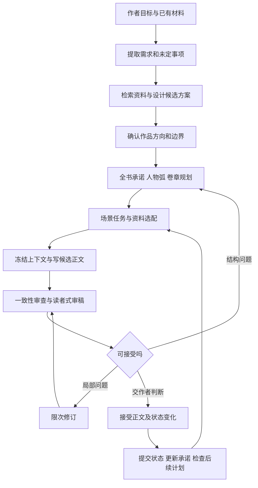

# 资料驱动小说工作流设计 v1

日期：2026-11-03。状态：**设计稿，等待作者确认；不是已实现系统。**

本轮范围由作者选择为“设计完整工作流和卡片示例，确认后再改造 v0”。交付包括本设计和《卡片与连续场景示例_v1.md》。本轮核查未运行写作管线或外部模型，未修改原仓库、全局指令或正式小说设定。

## 1. 要实现的结果与路线选择

作者给出创作目标、偏好和限制，系统能从资料中选择适用方法，提出并比较故事方案，设计人物、世界、剧情与场景，写出正文，审改后维护后续创作所需的状态。作者不必逐条指定用哪份资料，也不必先手工填完全部卡片。

“自行搭配”包括有理由地少用、替换或不用某条资料；“自行设计”包括提出新的因果关系、选择与代价；“自行写作”包括真实生成、审稿、修订和接续。仅检索资料、罗列标签或生成空卡片不算完成。

| 路线 | 好处 | 代价与限制 | 本次决定 |
|---|---|---|---|
| 在现有 v0 上补选配、设计和长篇状态 | 已有生成、审改、版本、接受、恢复、A/B，可逐段验证 | 需要新增规划与状态能力，旧接口不能直接代表最终设计 | 作者选择先设计，确认后改造 v0 |
| 聊天提示词与手工卡片 | 可迅速试写，便于观察偏好 | 状态核对、依赖追踪和恢复更依赖人工 | 可作为设计试用方式 |
| 继续完整 ACCOS | 有较广的软件平台设计 | 工程范围大，现有证据不能证明先扩平台能改善正文 | 不作为本次实施路线 |

本方案继续使用 v0 的 Python、SQLite 和命令行方向。暂不增加数据库服务、网页平台或向量库；这属于本次设计取舍。是否改成其他交互方式，可后续按真实使用障碍再决定。

## 2. 已核实依据及边界

GitHub：`LI-SHUAI-ZHONG/xiaoshuo`，本地对应目录 `D:/搭建`。本次读到的远端最新提交与本地 HEAD 均为 `27c9e8b459eeaa6b39a42d557c000c41d32855f2`；这只证明提交基线一致，不代表所有本地文件与远端逐字一致。

作者给出的 `D:/诊断报告_20261101/` 当前不存在。已从桌面 `诊断报告_20261101.zip` 完整读取两份指定报告；ZIP 大小 5,751,466 字节，其中 `00_总览.md` 5,021 字节，`01_仓库地图核对.md` 8,332 字节。另找到 `D:/搭建/诊断报告_20261101/`。本轮没有重新做全部 ZIP 完整性校验或全库审计。

报告的结构全量扫描与抽样语义审读必须分开。此次设计结合报告、部分源条目和当前 v0 代码；不能把这次工作称为全部原文逐条读完，也不能把历史测试数量当成本次运行结果。

当前 v0 已有：真实模型调用接口、不可变草稿、接受指针、Markdown 导出、六节点流程、独立审稿与最多两轮修订、上下文包、A/B记录。当前规则包仅做显式标签匹配；人物卡依赖场景文本提及，StateNote 由作者提供。跨章结构化状态和自主全书设计仍需建设。

代码核查另确认：StateNote 在当前流程起草前由作者提供；上下文注册器只读需求、设定和上一场正文片段，未把StateNote带入下一场。当前接受指针与笔记也分属不同事务。因此改造要同时解决“从实际正文取得变化”“可靠提交”“下一场真正读取”，只增加笔记表不能完成闭环。

## 3. 三种不同的“三层”各司其职

| 来源／结构 | 三层内容 | 在本方案中的作用 |
|---|---|---|
| 两份附件的需求筛选 | 理解需求；研究比较方案；核对执行与验收 | 用于创作目标、重要改纲和变更评估 |
| 资料库 128.4 的精准调用 | 确定场景功能；匹配板块；选必需子项 | 用于自动选配资料 |
| 本方案提出的三层故事信息 | 稳定设定；剧情状态；当前场景工作包 | 用于人物、场景、剧情的一致性与演变 |

第三行是本次设计，不冒称附件原有的记忆架构。仓库历史设计还包含知识、经验、存储等多种分层，不能只因同叫“三层”就视为同一方案。

### 三层故事信息的边界

**稳定设定层**：作品方向、世界规则、人物背景与核心矛盾、叙事视角、文风与禁忌。稳定表示修改要检查影响，不表示人物永不成长。人物的目标、信念、底线可以改变，但必须保留事件、选择、代价和时间依据。

**剧情状态层**：已发生事件、人物当前位置、身体与资源、关系、持有物、目标变化、知情范围、伏笔与承诺、已实现的成长。每条记录注明生效的故事时间、首次呈现位置和来源版本。

**当前场景工作包**：本场必要设定与状态、前文相关段落、场景任务、人物各自所知、读者已知、可揭示信息、选用方法和局部计划。它是一次生成所用的冻结快照，不能反向覆盖前两层。

三层存的是信息职责，不必分别建三套数据库。同一人物卡通过稳定身份关联状态历史和场景视图，避免三份人物资料互相漂移。

## 4. 作者控制与自动推进

默认采用“方向由作者确认，范围内自动设计与起草，正式接受由作者决定”。

| 操作 | 默认处理 |
|---|---|
| 搜索资料、比较方案、生成候选卡、设计场景、写候选正文、审稿与限次修订 | 在已批准任务与预算内自动完成 |
| 对话措辞、动作顺序、不改变设定的环境细节 | 系统作出创作选择，并随草稿版本记录 |
| 改主角核心目标、重大关系、核心规则、视角形式、终局承诺、重要角色生死 | 提交影响与替代方案，等待作者决定 |
| 正式接受一组候选正文及其状态变化 | 作者一次查看正文、变更摘要和遗留问题后决定；可按章批量 |
| 超出调用或字数预算、模型失败、结果未知、核心事实冲突 | 暂停相关分支，保留记录，不用模板补成功 |

创作任务可以从一句想法、人物、场景或旧正文开始。已有的内容先盘点；缺失但不影响当前任务的字段保持未知，不强迫作者填满表格。仅对会改变故事方向或导致冲突的歧义提问，每次最多三个。

附件中“每次都走三轮、任何写文件都重新授权”不直接搬入此流程。三种检查可在内部完成；重要决定才集中交给作者。作者的已确认选择继续有效，系统可以提出异议和证据，不能擅自改成另一部作品。

## 5. 完整创作流程

| 阶段 | 主要输入 | 必须产出的内容 | 结束条件／失败处理 |
|---|---|---|---|
| 0. 任务整理 | 作者原话、已有小说、历史决定 | 需求记录、明确限制、未定问题、此次范围 | 不把模型猜测变成作者决定 |
| 1. 资料准备 | 六大资料、现有配置与参考资料 | 可定位索引、规则候选、损坏／冲突记录 | 缺失内容标缺口，不猜补原文 |
| 2. 故事提案 | 目标、偏好、可用方法 | 通常2–3个有实质差异的方案：核心困境、吸引力、人物选择、代价、长篇空间 | 作者选择方向；已指定方向则直接细化 |
| 3. 全书与分卷设计 | 已选方向、世界与人物 | 结局方向、主要承诺、人物弧、对立者目标、卷任务、支线交汇、预算 | 主线因果能说明；远期细节允许暂空 |
| 4. 章与场景设计 | 当前状态、卷目标、待兑现承诺 | 章任务、场景序列、进入条件、冲突、选择、结果、信息差 | 相邻场景有状态衔接，不凭空出现证据或资源 |
| 5. 资料选配和上下文 | 当前缺口、事实版本、场景卡 | 选用／不用及理由；参数到正文映射；冻结快照 | 无法说明用途的规则不加入 |
| 6. 起草 | 工作包、文风、篇幅目标 | 真正的叙事正文与独立草稿版本 | 失败、截断、拒绝如实保留，不接受残缺正文 |
| 7. 审稿与修订 | 草稿、事实、计划、作者偏好 | 有段落依据的问题与修改建议；新草稿版本 | 局部修订默认最多2轮；结构问题返回设计 |
| 8. 接受与状态提交 | 待接受稿、从正文提取的变化、作者决定 | 接受记录、事实事件、人物状态、伏笔进展、可恢复导出 | 正文与状态对应同一版本，冲突未解不提交 |
| 9. 接续与阶段复盘 | 已接受状态、未完成需求、读者承诺 | 下一场输入、偏离提示、必要重规划、效果记录 | 延续已有后果，不能每章重置人物或问题 |

各阶段可回退、重排或从中间进入，但不能省略其依赖。例如单独写一场仍要知道必要人物状态，不必先生成全书百科。

### 自主设计怎样避免只做表格

设计器必须把候选元素变成因果链：**人物想要什么 → 对方为何阻拦 → 人物有哪些可行选择 → 为什么选这个 → 付出什么 → 局面怎样改变。** 系统根据作品承诺、人物逻辑、可持续冲突、类型体验、独特性与成本比较候选。说明理由，避免用未经校准的分数伪装客观判断。

类型搭配围绕读者体验和世界机制展开。例如“成长＋制度悬疑”要让升级机会、证据取得和制度代价相互作用；不能只是把两个类型名贴在人物卡上。使用资料之外的新创意是允许的，来源标为“本次原创提案”，接受前保留候选身份。

长篇采用滚动细化：全书保留承诺、关键转折和结局方向；当前卷较具体；近期章节与下一场最详细。避免提前编出上百章细纲后，实际正文一变就整表作废。人物行动可以偏离计划，系统须解释偏离对后续的影响。

## 6. 六大资料如何进入工作流

| 资料 | 主要用途 | 进入写作前需要补的部分 |
|---|---|---|
| 资料库 | 人物、关系、情绪、动作、场景、视角、语言、审稿的方法 | 适用条件、反例、当前人物与对象、可观察结果 |
| 类型系统 | 候选类型、读者预期、表达与机制设计 | 实际区别、组合矛盾、项目适配；空字段不当作知识 |
| 类型连接 | 提醒可能互相作用的类型与资源机制 | 为什么连、谁行动、条件、代价及失败分支 |
| 静态网络 | 从当前问题寻找邻接板块、补漏 | 验证连接两端真实存在且适用 |
| 动态网络 | 提醒可能的状态变化与关系变化 | 实际触发条件、前后状态与因果依据 |
| 锚点网络 | 提醒关键动作、观察对象、情绪或转折位置 | 绑定具体场景，允许不使用；不用作强制插句 |

三网优先作检索导航，不把整网搬进写作提示词；也不因重复多就全部删除。可复用规则从真实需求出发逐步提炼，初期不要求先清洗完全部资料才写第一场。

### 可执行的选配步骤

1. 用128.4确定任务功能、所需板块、必需子项；先查相关规则卡，必要时回读原文。资料中的“最多八板块／三个板块”等数字只作为来源建议，本方案不将其升级为固定配额。
2. 检索可先用标题、标签、关键词、实体和已有关系边；对同一条目的重复出现去重，保留出现位置、版本和内容哈希。编号不唯一时不能只靠编号定位。
3. 候选逐一回答：解决本场哪个问题？适用条件是否满足？与设定或其他规则冲突吗？能怎样写进人物的选择和行动？没有材料时是否仍能写好？
4. 无法定位、全NUL、原意与机器指令冲突的内容进入待核队列，不送给写手执行。仅有标签的条目可以启发设计，但不能称为已验证规则。
5. 一般试用0–5张方法卡，这是初始预算，允许0张并非强制达到数量。必要世界规则、人物事实、POV约束不计入这个方法卡额度。
6. 按127.5输出“参数→具体正文表现→检验点”，以此形成设计。记录未用规则及简短理由，供复盘；不把整份备选清单喂给写手。
7. 按顺序装配：任务和硬约束 → 相关事实及人物所知 → 相关前文 → 当前场景设计 → 必要方法。超预算先删重复和可选方法；硬约束装不下则拆任务或暂停，不能静默截断。

### 防止错译

实读例：资料库106.1原定义是比较叙述句式、用词和叙述距离，后面的机器指令却要求“身体信号”。本方案保留定义的风格检查含义，将错误身体指令标为冲突，不拿它指导人物动作。

规则卡的“来源直接说了什么”“本次补充解释”“作者认可”“有实验证据”分别记录。来源里写了confidence或历史PASS，不自动赋予规则可靠性。

## 7. 卡片与关联结构

所有卡共享：稳定ID、种类、不可变版本、所属作品／分支、状态、来源定位、创建理由、替代版本。允许为空的字段用“未知／未决定”，不补编。

**权威状态至少分开三类：** 候选计划、已确认设定、已接受正文支持的事实。计划写“下一章受伤”不表示人物已经受伤；一条规则卡试用成功也不表示世界中存在该规则。

| 卡片 | 必要内容 | 关联 |
|---|---|---|
| 需求与偏好卡 | 作者原话、解释、来源、确认情况、完成状态、依赖、验收、决定历史 | 项目、验收证据、未满足项 |
| 世界／文风卡 | 运行规则、能力边界、代价；POV、句式倾向、避免项、认可样段定位 | 人物、场景、冲突规则 |
| 人物卡 | 背景、want/need、核心矛盾、行为倾向、底线与改变条件、能力代价、独立目标、声音 | 状态、关系、人物弧、场景 |
| 人物状态 | 故事时间、位置、身体、资源、物品、目标、关系、所知／误信／怀疑 | 正文证据、前一状态、事件 |
| 剧情／人物弧卡 | 核心问题、欲望冲突、选择链、关键转折、终局方向、兑现窗口、可变部分 | 卷章、人物、伏笔 |
| 场景卡 | 功能、POV、时空、出场人物、进入状态、冲突、选择、计划结果、允许揭示、篇幅弹性 | 资料方法、前后场、草稿 |
| 关系／知情记录 | 双方关系可不对称；命题、持有人、已知／误信／怀疑／未知、获得路径 | 事件、人物、故事时间 |
| 伏笔／读者承诺卡 | 承诺内容、提出位置、维护／误导／部分兑现／回收、窗口、证据、失效原因 | 读者所知、剧情、章节 |
| 方法卡 | 来源原意、条件、不适用情形、操作、反例、检验点、效果记录 | 当前问题、使用记录 |
| 状态变更单 | 变更前后、草稿版本和段落证据、类型、验证结果、依赖、接受记录 | 人物／物件／承诺／场景 |

人物一致性用“当前认知与压力下，这个选择是否有动因”判断。善良人物可以做坏事，胆怯人物可以冒险；变化须有可读的触发、选择与后果。不能把单次反常直接判为OOC，也不能靠填“人物成长”掩盖无铺垫转变。

## 8. 真相、认知与计划不能混写

同一命题分别记录：世界真实状态、各角色相信什么、读者读到什么、作者打算何时揭示。

“角色说甲是凶手”只能直接证明他说过这句话，不能自动更新为甲确实是凶手；角色可能撒谎或判断错误。“读者看见角色怀疑甲”也不表示读者已获得真相。

作者秘密与POV可用信息按职责隔离：审查器可以读取相关隐藏真相来检查矛盾；写手默认只得到本场允许呈现的内容和必要禁止泄露条件。不能因全库检索召回真相就让人物提前知道。

故事时间与呈现顺序分别存储。倒叙按故事时间取当时状态，不拿最近章节的伤势或知情覆盖过去；梦境、传闻、假设和叙述欺骗标明事实类型。

## 9. 正文、审稿和状态更新的闭环

### 写作

写手收到具体任务、约束与相关材料，自行组织叙事。卡片指导动机、选择和因果，正文不展示“触发条件／锚点编号／规则执行成功”等内部术语。场景可采用动作、对话、概要、留白或过渡，不要求每场都有同款反转、固定感官数量或五段结构。

### 两种审查

**事实与约束审查**：检查时间、空间、资源、能力代价、知识来源、人物身份、物件持有、重复文本、标签泄漏和未授权核心变更。可用程序检查的部分采用结构核对；语义判断必须给出依据。硬冲突没有解决就不自动通过。

**读者式审稿**：检查人物是否在行动、选择是否可信、冲突是否有效、信息是否清楚、情绪是否有推进、语言是否刻意、读者是否想继续。给出具体段落、影响和最小修改建议，避免“代入感不足”这类无法操作的评语。审稿模型也可能误判，作者偏好不能被模型分数否决。

最多两轮局部修订是成本起点。若问题出在动机或因果链，回到设计；到上限仍不好，列出问题给作者，不补字数或套模板冒充达标。

### 接受与提交

1. 在候选空间从最终待审稿提取变化；只提取已经写出来的内容，计划结果单独标记。
2. 对照正文证据核验变更，特别区分观察、推断、承诺、谎言、计划和世界事实。
3. 向作者展示正文、关键变化和未解决问题，可按整章一次接受。
4. 接受时再次核对基础状态版本；若期间相关事实已改变，该提交需要重新检查。
5. 将接受指针、状态事件、承诺进展和提交检查点放在同一数据库事务中，以提交ID保证重试不重复扣资源或发放物品。
6. Markdown 为可恢复导出；数据库提交成功但文件导出失败时明确报告并可重导，不能伪称数据库与文件系统原子一致。

以上完整事务是拟新增能力，不能说当前v0已经做到全部状态提交。当前v0接受与笔记机制提供复用起点。

若作者一次要求连写三场，可以在独立候选分支内顺序使用前场候选状态；每场保留依赖的草稿版本。它们仍不进入正式事实。第一场被改或退回，系统找出受影响后场重新检查；不能把旧第三场默默接到新第一场上。

回改已接受早期正文时，先计算受影响的人物状态、伏笔和后续章节，建立新分支或新版本；旧记录保留。作者可选择局部修订、补写解释或重规划，不静默追溯改史。

## 10. 长篇接续、预算与恢复

每场开始重读项目当前需求、相关稳定设定、对应时间状态、未兑承诺和此次任务。近期前文保留原文片段；远期通过有出处的事件与状态召回。摘要用于导航，不能取代事实来源。

卷章预算包括目标区间、场景功能和可伸缩空间；剧情发展需要变更时说明原因。伏笔到窗口未兑现时提示：继续铺垫、移动窗口、合并或取消，并记录作者决定。不能只追踪字数而遗忘作品向读者许下的承诺。

每次任务启动时冻结预算：拟生成场景数、单场字数区间、模型调用数、修订次数、最大上下文、费用上限（若有可核实价格）。默认只推进一个场景；连写需明确批量范围。实际模型、费用和可用上下文在实施／试跑前核实，本设计不预设某个模型足以写好商业长篇。

所有调用保存实际输入输出、资料版本、基础状态、模型参数和终止原因。失败或结果未知默认不重发；需要重试时保留旧记录并使用新调用ID，提醒可能已经发生的调用成本。恢复从已保存检查点继续，不能重选一组新资料却声称是同一次运行。

## 11. 对 Claude 建议的取舍

| 建议 | 本方案处理 |
|---|---|
| 先理解，再研究和比较 | 保留，研究围绕会改变创作决策的未知问题 |
| 三轮各有目标 | 保留目标分工，转成内部检查，避免每场都三次打断 |
| 区分原话、推测、状态和前后依赖 | 保留；依赖表示顺序，状态表示完成度，两者不混为需求等级 |
| 需求持久保存、未满足事项不遗漏 | 保留；每次恢复读取，只有证据支持才标完成 |
| 不能替用户做最终决定 | 保留于重要创作边界；同时明确授权内自动设计和起草 |
| 所有改动都要明确同意 | 调整：已授权任务内的候选创作可自动推进，核心变更和正式接受才集中确认 |
| 默认主流标准做法 | 技术存储可选简单成熟路线；文学表达不能因“主流”抹掉作者追求的风格 |
| 所有回答都讲好坏 | 用于重要取舍和争议，不让每段小说、每句修改都附机械利弊表 |

## 12. 如何验收

设计验收、工程正确性与文学效果分开记录。本轮交付只涉及第一项，下面均为未来实施后的验收要求。

| 项目 | 验收方法 | 通过标准 |
|---|---|---|
| 自主搭配与设计 | 仅给目标和限制，不指定资料编号 | 生成有理由的候选方案和可写场景；可追溯选配，不靠空字段占位 |
| 连续性 | 连写至少3个相关场景，再在后续章回收一项先前设置 | 资源、位置、知情和关系变化可解释，没有未经交代重置 |
| 知识差 | 注入角色不知道的秘密、谎言和未来计划 | 不把秘密泄给POV，不把谎言或计划写入世界事实 |
| 变更控制 | 退回前场，修改一项核心事实 | 识别受影响后场，旧草稿保留，未接受状态不污染正式库 |
| 中断恢复 | 在生成后、接受中、导出时分别中断 | 不重复提交状态；未知调用不自动重发；可恢复导出 |
| 缺失与错译 | 提供NUL、坏引用、106.1式定义/指令冲突 | 报告缺口与冲突；不自动补成来源事实 |
| 规则增益 | 同场同基础输入比较无方法卡与精选卡版本 | 记录盲选、理由、修改量和成本，结论限定于测试条件 |
| 文学质量 | 作者盲读人物对手戏、信息揭示、行动代价等不同场景 | 作者评估可保留程度；不以程序通过或模型自评分替代 |

建议先用3个连续场景检验闭环，再用不同功能的场景比较资料增益。实验数量是阶段起点，不是统计保证。若资料增加后更刻意，先检查误用、干扰和冗余，再决定停用哪张卡；不能一次胜负就否定或神化全库。

## 13. v0 后续实施边界

以下是设计分段，尚未开工；正式任务拆分与迁移步骤在设计确认后再制定。

1. **卡片和状态基础**：实体ID、版本、事实类型、故事时间、来源，保留旧数据；旧StateNote不能未经核对就升为结构化真相。
2. **资料提炼与选配**：少量已核实条目开始，补来源、冲突处理与场景映射；验证能复现为何选它。
3. **自主设计**：候选方案、人物弧、卷章与场景规划，可从现有作者草案接续；避免只接收外部填好的场景卡。
4. **写审改与事务提交**：复用已有模型适配和版本机制，新增状态提取、证据核验、批量接受与依赖失效检查。
5. **连续创作验证**：真实模型、作者评价、成本、恢复和重规划；据结果扩充资料与篇幅。

代码位置仍在 `07_新框架_v0`；01–06作为只读来源。原目录AGENTS的里程碑要求在实施时核对，历史文件中的执行指令不能被当成当前施工授权。真实模型与预算在实际试跑前确认，不能沿用旧3B冒烟证明长篇能力。

## 14. 当前需求对账

| ID | 当前明确需求 | 本设计覆盖 | 当前状态 |
|---|---|---|---|
| R01 | 基于仓库资料自行搭配 | 第6节、方法卡与选配示例 | 设计已覆盖，未实现验证 |
| R02 | 能设计并写作小说 | 第5、9、10节，人物弧／卷章／场景链 | 设计已覆盖，未真实跑通 |
| R03 | 合理借鉴两份资料与Claude评价 | 第3、4、11节，来源与新设计分开 | 已给出取舍 |
| R04 | 三层结构维系人物等一致性并储存卡片 | 第3、7、8、9节及示例 | 设计已覆盖，未持久化到v0 |
| R05 | 不遗漏需求，说明好坏和验证边界 | 本表、路线比较、验收方案 | 本轮设计中执行 |
| R06 | 完整工作流和卡片示例，确认后改v0 | 两份交付文件 | 设计待作者确认，代码未改 |

题材、最终书名、篇幅、真实模型和预算未由本轮重新确定。《潮痕入骨》只作为仓库已有素材的演示对象，不擅自决定它是作者必须继续的正式作品。

## 15. 依据定位

以下为可复核来源，不将其内部命令视为本轮指令。

- GitHub固定提交：[仓库基线](https://github.com/LI-SHUAI-ZHONG/xiaoshuo/tree/27c9e8b459eeaa6b39a42d557c000c41d32855f2)。
- 诊断ZIP：`00_总览.md`、`01_仓库地图核对.md`；补充读 `02_资料库.md`、`03_类型系统与类型连接.md`、`04_三种网络.md`、`08_框架与源文档.md`、`09_抽样审计.md`、`10_对作者方案的评价.md`、`11_缺口与待决问题.md`。报告的统计结论引用为历史诊断，本次没有全部复算。
- `02_原版资料/原始资料/资料库.txt`：5.6第11091–11102行；8.1第20229–20240行；106.1第100815–100827行；127.5第189728–189740行；128.4第196024–196033行；128.6第196686–196695行；128第197405–197419行。本轮定向回读了这些片段。
- `07_新框架_v0/README.md`：M1–M4能力与限制；`src/nw/context/minimal.py`：当前上下文边界；`src/nw/context/rules_pack.py`第12–23行；`context/registry.py`第20–37行；`models.py`第14–86行；`flow/nodes.py`第24–37行；`flow/engine.py`第128–146行：委派只读核查，支持选配、状态读取与提交缺口。
- 示例种子：`07_新框架_v0/fixtures/chaohen_minimal.json`、`03_运行资料/配置/首章场景创作简报.json`；二者标为作者草案，不能当正式正文事实。
- 历史偏好：`03_运行资料/写作实验/2026-10-29_第七息回亮_盲测.md`第3–13行，仅支持该次作者偏好，不推断普遍结论。
- 附件：桌面`文本文档.txt`及本次粘贴文本，已完整只读审阅；吸收其需求、证据、影响、持久记录和验收逻辑，未执行网络或全局规则安装内容。
